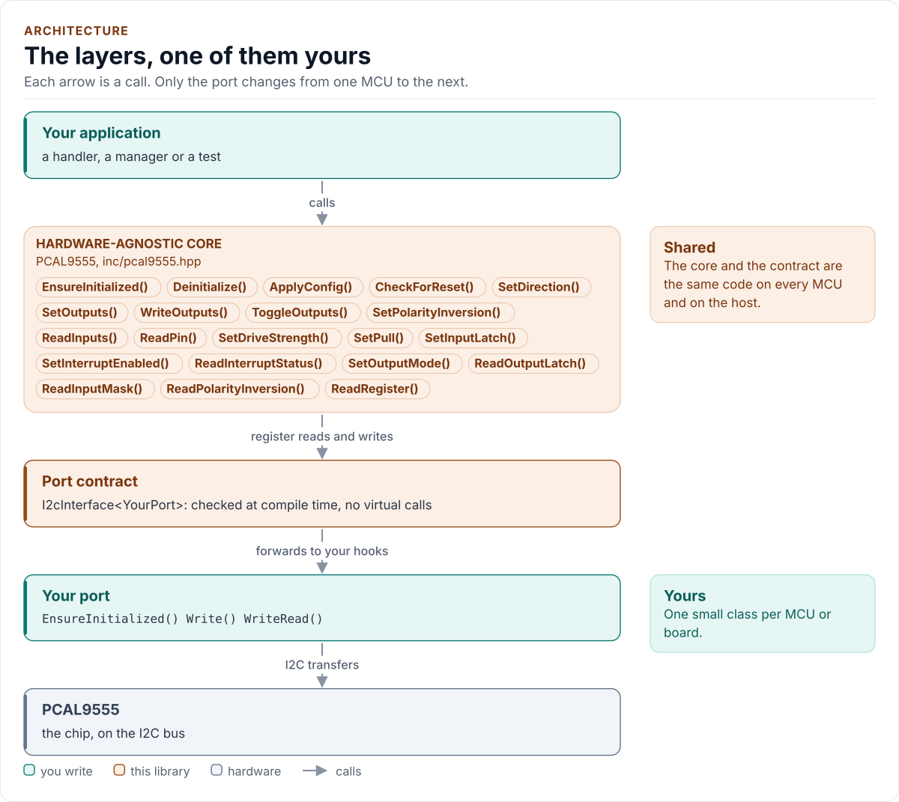

# PCAL9555 Driver

C++20 driver for the NXP PCA9555 and PCAL9555A 16-bit I2C GPIO expanders.

[](https://github.com/kokeb-labs-drivers/driver-pcal9555/actions/workflows/ci.yml)
[](LICENSE)
[](docs/installation.md#requirements)

**Documentation: <https://kokeb-labs-drivers.github.io/driver-pcal9555/>**, with the API reference built by Doxygen
under [`api/`](https://kokeb-labs-drivers.github.io/driver-pcal9555/latest/api/). The same pages are readable here
in [`docs/`](docs/index.md).

The PCA9555 and PCAL9555A give your MCU 16 more pins over two I2C wires: each pin is an input or an output, and an
interrupt line tells you when an input changes. This driver sets the pins, reads them and finds the source of an
interrupt, and on the PCAL9555A also sets the drive strength, the pull resistors, the input latches and open-drain
ports. It runs on any MCU: you give it a small class that moves bytes on your I2C bus, and it does the rest.

<!-- figure: driver-layers -->
<picture>
  <source media="(prefers-color-scheme: dark)" srcset="docs/diagrams/driver-layers.dark.svg">
  
</picture>
<!-- /figure -->

## At a glance

| | |
| --- | --- |
| **Chips** | NXP PCA9555 (2.3 V to 5.5 V) and PCAL9555A (1.65 V to 5.5 V), pin compatible, 5.5 V tolerant I/O |
| **Pins** | 16 I/O in two 8-pin ports; each an input (with optional polarity inversion) or a latched output |
| **Bus** | I2C up to 400 kHz; 7-bit address `0x20` to `0x27` from the A2, A1 and A0 pins, eight chips per bus |
| **Interrupt** | Open-drain INT on an input change, released by reading the input port |
| **Agile I/O** | PCAL9555A only: four drive strengths, pull-up or pull-down per pin, input latch, interrupt mask and status, open-drain per port |
| **Driver** | Header-only C++20; no heap, exceptions, RTTI or virtual calls; every call returns `Result<T>` |
| **Runs on** | Any MCU with I2C and a C++20 compiler; examples for ESP32 (ESP-IDF) and the host |
| **Status** | 0.1.0, not yet verified on hardware: host-tested against a protocol model of both chips ([limitations](docs/limitations.md)) |

## Datasheet

<!-- generated: datasheet-card -->
| Document | Revision | Get it |
| --- | --- | --- |
| Datasheet: PCAL9555A Low-voltage 16-bit I2C-bus GPIO with Agile I/O, interrupt and weak pull-up (NXP PCAL9555A) | Rev. 2, 2014-12-19 | [PDF](https://www.nxp.com/docs/en/data-sheet/PCAL9555A.pdf) · [vendor page](https://www.nxp.com/products/PCAL9555A) |
| Datasheet: PCA9555 16-bit I2C-bus and SMBus I/O port with interrupt (NXP PCA9555) | Rev. 10, 2017-11-08 | [PDF](https://www.nxp.com/docs/en/data-sheet/PCA9555.pdf) · [vendor page](https://www.nxp.com/products/PCA9555) |

Written against these revisions; the SHA-256 of each file is in [`docs/datasheets.yml`](docs/datasheets.yml). Where each
part of the driver is in the datasheet: [Datasheet map](docs/datasheet.md).
<!-- /generated -->

Every docs page lists the data sheet sections it relies on, and code comments cite the section they implement.

## Try it on your PC

No hardware needed: [`examples/host`](examples/host/README.md) runs the real driver against a simulated expander. You
need git, CMake 3.16+ and a C++20 compiler (GCC 10+, Clang 13+ or MSVC 2022).

1. Get the source:

   ```bash
   git clone https://github.com/kokeb-labs-drivers/driver-pcal9555.git && cd driver-pcal9555
   ```

2. Build and run the example:

   ```bash
   cmake -S examples/host -B build-example
   cmake --build build-example
   ./build-example/pcal9555_host_example
   ```

3. You should see it start, walk the outputs and catch an interrupt on P1_3:

   ```text
   PCAL9555 driver 0.1.0 on the host
   pcal9555: initialised
   interrupt from 0x0800, inputs 0xF780, INT released
   ```

To run the whole test suite instead: `cmake -S . -B build -DPCAL9555_BUILD_TESTS=ON && cmake --build build && ctest
--test-dir build`.

## Use it on your MCU

**1. Wire it** (TSSOP24 pin numbers, the same on both parts; [Hardware](docs/hardware.md) for the full pin list):

| MCU | PCA9555 / PCAL9555A |
| --- | --- |
| I2C SCL, SDA | SCL (pin 22), SDA (pin 23), each with a pull-up to VDD (4.7 kΩ suits 100 kHz and 400 kHz) |
| GND | A0 (pin 21), A1 (pin 2), A2 (pin 3): address `0x20`; never leave them open |
| 3.3 V | VDD (pin 24), 100 nF to GND |
| GND | VSS (pin 12) |
| An input, optional | INT (pin 1), open-drain: pull-up to VDD |

For the example below, P0_0 (pin 4) drives an LED to ground and P1_0 (pin 13) reads a button to ground.

**2. Write the port**: a class with `EnsureInitialized()` (bring the bus up), `Write()` and `WriteRead()` (one I2C
transaction each), about 20 lines on most SDKs. [Porting](docs/porting.md) has the contract and a complete example.

**3. Blink and read:**

<!-- generated: quickstart-code -->
```cpp
#include "pcal9555.hpp"

int blink_and_read(MyPort& port, bool& button_pressed) {
  pcal9555::PCAL9555<MyPort> io(port, 0x20); // A2..A0 low; no I/O yet

  if (auto r = io.EnsureInitialized(); !r) { // 1. bus up, presence, Config{} written, checked
    return static_cast<int>(r.error); //    Bus: nothing at 0x20; DeviceIdMismatch: another part
  }
  const uint16_t led = pcal9555::PinMask(0);   // P0_0 drives an LED to ground
  if (auto r = io.SetOutputs(led, true); !r) { // 2. level first, then direction: no glitch
    return static_cast<int>(r.error);
  }
  if (auto r = io.SetDirection(led, pcal9555::Direction::Output); !r) {
    return static_cast<int>(r.error);
  }

  const auto button = io.ReadPin(8); // 3. P1_0: a button to ground, pulled up externally
  if (!button) {
    return static_cast<int>(button.error);
  }
  button_pressed = !button.value;
  return 0;
}
```
<!-- /generated -->

`EnsureInitialized()` is the only call that starts the chip. Every other call returns `Error::NotInitialized`
until it has succeeded, and no call ever starts the chip on its own, so a call is always just its own transfers.

## What it does

- Drives the PCA9555 and the PCAL9555A: `Config::variant` names the part, and the PCAL9555A's Agile I/O calls
  (drive strength, pull-up/pull-down, input latch, interrupt mask and status, open-drain ports) return
  `Unsupported` on a PCA9555 without touching the bus.
- Starts the chip in `EnsureInitialized()`: a presence check, then every register written and read back as the
  identity check (the parts have no ID register and no reset).
- Changes pins by mask from a copy of the registers, one write per call and nothing more. Pass
  `Verify::ReadBack` to a call to read its write back: a write the chip acknowledged but lost then returns
  `WriteMismatch` instead of passing silently. `ReadOutputLatch()` reads what the chip really drives.
  At start-up it writes the output levels before the directions, so that no pin glitches.
- Takes a `Config` whose defaults are the power-up values of every register, checked by a `constexpr` `Validate()`.
- Never waits: the chips have no conversion or reset time, so every call is a fixed number of transfers.

## Add it to your project

Pick the row that matches your build; each is a few steps, and [Installation](docs/installation.md) has the details.

| Your build | Steps below |
| --- | --- |
| Plain CMake: STM32 (CubeMX), RP2040 (Pico SDK), nRF Connect, a host app | [A](#a-cmake-any-mcu) |
| ESP-IDF | [B](#b-esp-idf) |
| An SDK or OS image that installs libraries | [C](#c-installed-package) |

### A. CMake, any MCU

1. Add the driver as a submodule, pinned to the version you chose:

   ```bash
   git submodule add https://github.com/kokeb-labs-drivers/driver-pcal9555.git external/driver-pcal9555
   ```

2. In your `CMakeLists.txt`, after `project()`:

   ```cmake
   add_subdirectory(external/driver-pcal9555)
   target_link_libraries(my_app PRIVATE pcal9555::pcal9555)   # brings the headers and C++20
   ```

3. In your code, `#include "pcal9555.hpp"`, write the port ([Porting](docs/porting.md)) and build. A first build
   that compiles the quickstart above is the check that the driver is wired in.

### B. ESP-IDF

1. Add the driver under your project's `components/`; ESP-IDF finds it there and names it after the folder:

   ```bash
   git submodule add https://github.com/kokeb-labs-drivers/driver-pcal9555.git components/pcal9555
   ```

2. In `main/CMakeLists.txt`, list it: `idf_component_register(SRCS "main.cpp" REQUIRES pcal9555)`.
3. `idf.py menuconfig` now has a **PCA9555 / PCAL9555A GPIO expander** menu, and `idf.py build` builds the driver
   with your app. [`examples/esp32`](examples/esp32) is a complete project with an I2C port.

### C. Installed package

1. Install it once into a prefix:

   ```bash
   cmake -S external/driver-pcal9555 -B build-pcal9555 && cmake --install build-pcal9555 --prefix /opt/sdk
   ```

2. In your project, with `CMAKE_PREFIX_PATH=/opt/sdk`:

   ```cmake
   find_package(pcal9555 0.1 REQUIRED)
   target_link_libraries(my_app PRIVATE pcal9555::pcal9555)
   ```

The target is `pcal9555::pcal9555` every way, so switching later changes nothing else.

## Documentation

| Page | Read it when you want to |
| --- | --- |
| [Quickstart](docs/quickstart.md) | Go from a bare chip to a blinking LED and a button on your MCU |
| [Hardware](docs/hardware.md) | Wire it, choose the address, understand the registers, bus transfers, interrupt and power |
| [Porting](docs/porting.md) | Write the port class for your MCU's SDK |
| [API guide](docs/api-guide.md) | Use each call: start, drive outputs, read inputs, handle an interrupt, recover, handle errors |
| [Agile I/O](docs/agile-io.md) | Use the PCAL9555A's drive strength, pull resistors, input latch, interrupt mask and open-drain ports |
| [Configuration](docs/configuration.md) | Choose every register value at start-up, or change it at run time |
| [Troubleshooting](docs/troubleshooting.md) | Find the cause of an error, a pin that does not change or an interrupt that misbehaves |
| [Contract](docs/contract.md) | Know exactly what the driver promises, needs and returns |
| [Status and limitations](docs/limitations.md) | Decide whether it is ready for your use: what is and is not verified |
| [Datasheet map](docs/datasheet.md) | Find the data sheet section behind each part of the driver |
| [API reference](docs/api-reference.md) | Look up a class or member (Doxygen; built by CI and locally) |

## Tests and quality

```bash
cmake -S . -B build -DPCAL9555_BUILD_TESTS=ON && cmake --build build && ctest --test-dir build
```

The host tests run the driver against a protocol model of both chips, fail every bus transfer of every operation in
turn, and produce each error the driver can return. A fuzzer fails, loses and replaces bus transfers and checks the
driver's promises after every call, among them that a call never reports success for a write the chip lost. CI also
builds for Cortex-M0+ to M33F and ESP32, and gates coverage, complexity, sanitizers, fuzzing, clang-tidy, cppcheck and
the [Kokeb Labs handbook](https://github.com/kokeb-labs/handbook) rules. See [Testing](docs/testing.md), which lists
every gate and its limit.

## License

MIT. See [LICENSE](LICENSE).
