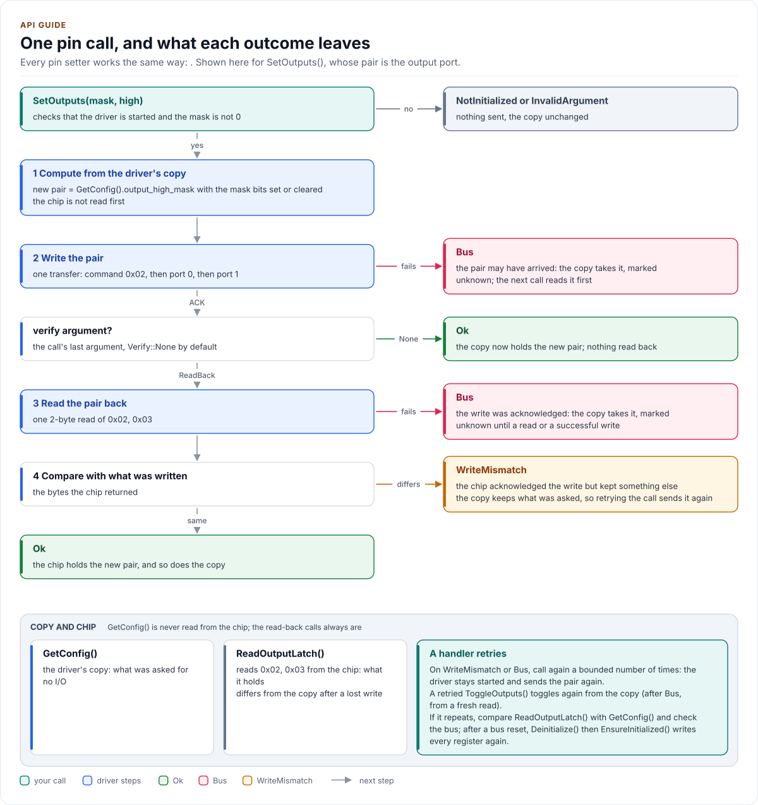

# API guide

The driver's API by task, with code that compiles: start, drive outputs, read inputs, handle an interrupt, stop
and handle errors. The PCAL9555A extras have their own page, [Agile I/O](agile-io.md).

<!-- generated: datasheet-refs -->
??? abstract "Datasheet sections this page relies on"

    - Input, output, polarity inversion and configuration registers: NXP PCAL9555A Rev. 2, 6.2.2 to 6.2.5 Input port, Output port, Polarity inversion and Configuration register pairs, [p. 7](https://www.nxp.com/docs/en/data-sheet/PCAL9555A.pdf#page=7)
    - Interrupt status: NXP PCAL9555A Rev. 2, 6.2.11 Interrupt status register pair, [p. 12](https://www.nxp.com/docs/en/data-sheet/PCAL9555A.pdf#page=12)
    - Power-on reset: NXP PCAL9555A Rev. 2, 6.4 Power-on reset; 8.3 Power-on reset requirements, [p. 13](https://www.nxp.com/docs/en/data-sheet/PCAL9555A.pdf#page=13)
    - Interrupt output (INT): NXP PCAL9555A Rev. 2, 6.5 Interrupt output, [p. 14](https://www.nxp.com/docs/en/data-sheet/PCAL9555A.pdf#page=14)
    - Power-on reset: NXP PCA9555 Rev. 10, 6.3 Power-on reset, [p. 8](https://www.nxp.com/docs/en/data-sheet/PCA9555.pdf#page=8)
    - Interrupt output (INT), no mask or status: NXP PCA9555 Rev. 10, 6.5.3 Interrupt output, [p. 14](https://www.nxp.com/docs/en/data-sheet/PCA9555.pdf#page=14)

    All of them, with the driver API for each: [Datasheet map](datasheet.md).
<!-- /generated -->

## The shape of the API

| Group | Calls |
| --- | --- |
| Lifecycle | `EnsureInitialized()`, `IsInitialized()`, `Deinitialize()` |
| Configuration | `ApplyConfig()`, `GetConfig()`, `GetAddress()` |
| Pins (both parts) | `SetDirection()`, `SetOutputs()`, `WriteOutputs()`, `ToggleOutputs()`, `SetPolarityInversion()`, `ReadInputs()`, `ReadPin()` |
| Agile I/O (PCAL9555A) | `SetDriveStrength()`, `SetPull()`, `SetInputLatch()`, `SetInterruptEnabled()`, `ReadInterruptStatus()`, `SetOutputMode()` |
| Free functions | `Validate()`, `PinMask()`, `AddressFromPins()`, `DriveStrengthAll()`, `ToString()`, `GetDriverVersion()` |

Every call that touches the chip returns `Result<T>`: check `ok()` (or the `bool` conversion) and read `value`, or
read `error`. `Result` is `[[nodiscard]]`, so an unchecked call is a compiler warning. A failed call's `value` is
`T{}`, never a stale or partial reading.

Pins are numbered 0 to 15: 0 to 7 are P0_0 to P0_7, 8 to 15 are P1_0 to P1_7. The calls that change pins take a
mask, bit n for pin n (`PinMask(n)`), and change only the pins in it; a mask of 0 is `InvalidArgument`.

## Start

```cpp
--8<-- "tests/docs/api_tasks.cpp:lifecycle"
```

The constructor stores the port, the address and the configuration and does no I/O. `EnsureInitialized()` is the
one way to start the chip. Its first call checks the configuration (`Validate()`) and the address, brings the bus
up, reads the input ports to see that a part ACKs, on a PCAL9555A reads 0x4F and checks that its reserved bits are
0, then writes every register of the configuration and reads each back. A register that does not hold what was
written means another part answers at the address: `DeviceIdMismatch`.

Once it has succeeded, `EnsureInitialized()` returns `Ok` at once with no I/O, so a caller (or a handler that owns
the driver) can call it before every use. After a failure the driver stays uninitialised and the next call starts
again from the beginning. No other call starts the chip: before `EnsureInitialized()` succeeds every read and write
returns `NotInitialized` and sends nothing. `ApplyConfig()` before the start only stores the configuration for the
first `EnsureInitialized()`.

The chip has no reset, so the start-up writes every register instead: the result is the same whatever the chip
held before, a power-up or a previous run of the firmware.

## Drive outputs

```cpp
--8<-- "tests/docs/api_tasks.cpp:outputs"
```

| Call | Register pair | Effect |
| --- | --- | --- |
| `SetOutputs(mask, high)` | Output port | Pins in `mask` high or low |
| `WriteOutputs(high_mask)` | Output port | All 16 at once |
| `ToggleOutputs(mask)` | Output port | Pins in `mask` inverted |
| `SetDirection(mask, Direction::Output)` | 0x4F, output port, configuration | Pins in `mask` drive their output value |

Set the level before the direction: a pin that becomes an output drives its output latch at once, and the latch is
high after power-up. The output latch is kept for input pins, so it can be prepared while the pin is still an input.

`SetDirection()` is the one pin call that sends more than its own register. A pin that becomes an output drives its
latch through its port's output stage, and a power-on reset sets every latch high and every stage push-pull (table
4). So it first checks for a reset (one read, see [Recover after a power loss](#recover-after-a-power-loss)), then
writes from the driver's copy in the data sheet's order (section 6.2.12): 0x4F on a PCAL9555A, the output pair, the
configuration pair. Whatever the chip went through, no pin becomes an output at a level or stage you did not set.
It costs one read and two write pairs on a PCA9555, plus a 1-byte write on a PCAL9555A (about 0.3 ms at 400 kHz
instead of 90 µs); call it at configuration time, not in a fast loop.

Releasing pins (`Direction::Input`) is the safe direction, and the cheapest. When every pin ends up an input,
the configuration pair is the only transfer: no check, nothing before it that could fail, since nothing can be
driven whatever the chip went through. When other pins stay outputs, the reset check comes first, then the
configuration pair, so the pins are released by the first write, then 0x4F and the output pair for the remaining
outputs.

The driver keeps a copy of every register it wrote (`GetConfig()`), computes the new pair from it and writes the
pair in one transfer, without reading it first: by default a pin call other than `SetDirection()` is the one 3-byte
write the data sheet needs and nothing more. Read-back is chosen per call: every setter takes a last argument
`Verify`, `Verify::None` by default. With `Verify::ReadBack` the call then reads the pair back, a 2-byte read that
more than doubles its bus time, and a write the chip acknowledged but did not keep returns `Error::WriteMismatch`.
An acknowledge carries no checksum, and the data sheet allows for a glitch or data corruption (section 8.3); the
output port reads back the value it holds, not the pin (section 6.2.3), so the read-back shows what the chip will
drive. Pass `Verify::ReadBack` on the calls where a lost write matters more than the bus time, such as a driver
enable, and leave the hot path at the default.

A write whose transfer failed (`Bus`, `NoDevice`) may still have reached the chip: the bytes can be stored before a
lost ACK or a NACK of the last byte. So after a failed write the copy does not keep the old value as if nothing
happened. It takes the riskier of the old and the asked value, and the register is marked unknown:

| Register pair | The copy after a failed write |
| --- | --- |
| Configuration (`input_mask`) | A pin that was or was asked to be an output counts as an output (old AND asked) |
| Output port (`output_high_mask`) | The written level |
| Drive strength (`drive_strength_codes`) | The stronger code of each pin |
| 0x4F (`port0_mode`, `port1_mode`) | Push-pull if either was push-pull |
| Polarity, input latch, pull enable and selection, interrupt mask | The written value |

The next call that builds on an unknown register first reads it from the chip into the copy (one more read, only
after a failure), so it never computes a new value from a stale one; a successful write of the pair, a read-back
call (`ReadOutputLatch()`, `ReadInputMask()`, `ReadPolarityInversion()`), `ApplyConfig()` and `EnsureInitialized()`
make it known again. An unknown register read back at its power-up value is taken as a reset, `DeviceReset`; any
other value is adopted. When the failed write's old or new value was itself the power-up value, that is a false
`DeviceReset`: one time, nothing written, and `EnsureInitialized()` recovers. After a failed `ApplyConfig()`
the registers written before the failure hold the new values, the one that failed is unknown, and the rest keep
the old ones.

`GetConfig()` is the driver's copy, so after a failed write it shows the riskier value for the direction, the
drive strength and 0x4F, and the written level for the outputs: not necessarily what the pins do. Read the chip
with `ReadOutputLatch()` (and `ReadInputMask()`) when it matters.

<!-- figure: pin-write -->
<picture>
  <source media="(prefers-color-scheme: dark)" srcset="diagrams/pin-write.dark.svg">
  
</picture>
<!-- /figure -->

## Read back what the chip holds

```cpp
--8<-- "tests/docs/api_tasks.cpp:readback"
```

| Call | Register pair | Returns |
| --- | --- | --- |
| `ReadOutputLatch()` | Output port | The level each pin is told to drive |
| `ReadInputMask()` | Configuration | 1 for each input pin |
| `ReadPolarityInversion()` | Polarity inversion | 1 for each inverted input |

`GetConfig()` is what the driver asked for; these read the chip. For an output pin, `ReadInputs()` returns the
level on the pin, which a load or another driver on the line can pull away from the latch: to know what the expander
is driving, read the latch. Each is one 2-byte read, and none changes a register or clears an interrupt.

## Read inputs

```cpp
--8<-- "tests/docs/api_tasks.cpp:inputs"
```

`ReadInputs()` reads both input ports in one transfer and returns the level of every pin, outputs included, after
polarity inversion. `ReadPin(pin)` reads only the port of that pin. `SetPolarityInversion(mask, true)` inverts how
input pins read, for active-low signals. Reading an input port also releases the interrupt of that port.

Reading an input port also clears the chip's interrupt status for that port (sections 6.2.11, 6.5), before anything
else could read it. So on a PCAL9555A with at least one input whose interrupt is unmasked, `ReadInputs()` and
`ReadPin()` first read the interrupt status pair into `GetLatchedInterrupts()`: one more 2-byte read (113 µs at 400
kHz). With every input masked, and on a PCA9555, they stay one read. `ReadRegister(0x00)` stays a raw read without
it.

## Diagnose on the bench

```cpp
--8<-- "tests/docs/api_tasks.cpp:diagnostics"
```

| Call | I/O | Returns |
| --- | --- | --- |
| `ReadRegister(command)` | One 1-byte read, no retry | Any register the configured part implements (0x00 to 0x07; on a PCAL9555A also 0x40 to 0x4D and 0x4F); any other command byte is `InvalidArgument` with nothing sent |
| `GetLastInputs()` | None | The input ports as the driver last read them: `ReadInputs()`, `ReadPin()`, a raw read or the start-up presence check |
| `GetLastOutput()` | None | The output port registers as the chip last reported them: `ReadOutputLatch()`, a `Verify::ReadBack` of an output write, the start-up read-back or a raw read |
| `GetLatchedInterrupts()` | None | Every pin any interrupt status read reported since `ClearLatchedInterrupts()`, ORed together |
| `ClearLatchedInterrupts()` | None | Empties that latch; the chip is not touched |

Reads have the chip's own side effects and no others: a raw read of an input port (0x00, 0x01) clears that port's
interrupt, as `ReadInputs()` does. Reading the input ports clears the chip's interrupt status too, which is why the
driver keeps every status it read in the latch until you clear it (handbook KB-CPP-119). Keeping the last values
costs two compares per read and no I/O; the hot path is otherwise unchanged.

## Handle an interrupt

```cpp
--8<-- "tests/docs/api_tasks.cpp:interrupt"
```

INT is open-drain, active low. Never call the driver from the ISR: every call blocks on the bus. Let the ISR wake a
task, which then reads. On a PCAL9555A, `ReadInterruptStatus()` names the pins that raised INT (and does not clear
it; the driver also ORs it into `GetLatchedInterrupts()`); `ReadInputs()` then releases it. A status that only an
input read saw is not lost either: with an unmasked input, the input read latches the status first. On a PCA9555
there is no status register: compare `ReadInputs()` with the last value. Both parts and the input latch are on
[Hardware](hardware.md#interrupt) and [Agile I/O](agile-io.md).

## Stop

```cpp
--8<-- "tests/docs/api_tasks.cpp:deinit"
```

`Deinitialize()` makes every pin an input, the power-up direction, so the chip drives nothing, and marks the driver
uninitialised. The driver keeps its copy of the registers, pin changes included: the next `EnsureInitialized()`
writes it all again.

## Recover after a power loss

```cpp
--8<-- "tests/docs/api_tasks.cpp:reset"
```

The chip resets every register when its supply drops below the power-on reset voltage (section 6.4): every pin an
input, every output latch high, both ports push-pull, every interrupt masked (table 4). It has no reset pin and no
reset flag, so the driver looks for the reset in the registers: `CheckForReset()` reads one register whose copy
differs from its power-up value (the Agile I/O pairs and the polarity pair first, then 0x4F, the configuration pair
and the output pair) and returns `Error::DeviceReset` when it reads its power-up value. Nothing is written, the
driver is uninitialised, and `EnsureInitialized()` writes the copy again in the data sheet's order. When every
register of the copy is at its power-up value, nothing is sent: a reset then leaves the chip as the driver believes
it to be.

`SetDirection()` and `ApplyConfig()` run the same check first, and so does a setter about to rewrite the register
the check reads, unless that register is the only one off its power-up value (its write then leaves the chip right
after a reset or a lost write alike). Call `CheckForReset()` where a supply dip is possible: once per control
period, or before an output change that matters. A write to the checked register that the chip acknowledged but
dropped reads the same way; the recovery is the same.

If a call returns `Bus` or `NoDevice`, start again too: `Deinitialize()` (a failing write still leaves the driver
uninitialised), then `EnsureInitialized()`, which writes every register from the driver's copy. The ESP32 example
does both.

## Use it from a handler

On a board, the driver usually sits under a handler that owns it, the port and the bus, and that hands pins to the
rest of the firmware. The driver leaves to the handler what it cannot know:

- **Start-up.** The handler calls `EnsureInitialized()` from its own lazy start; the driver never starts itself, so
  a read before it returns `NotInitialized` instead of doing hidden I/O on a time-critical path.
- **Retries.** The driver never retries. On `WriteMismatch` or `Bus` from a pin call, retry the call a bounded
  number of times and count the attempts (handbook KB-ARCH-044); the driver stays started. Every pin call writes a
  whole register pair from the copy, so repeating it is safe. On `NoDevice` do not retry the call: the chip is gone
  or unpowered, so recover as below. After `WriteMismatch` the copy holds
  what was asked for, so an absolute call (`SetOutputs()`, `WriteOutputs()`, `SetDirection()`, ...) can simply be
  repeated; a relative one, `ToggleOutputs()`, cannot (it would toggle back): resend with
  `WriteOutputs(GetConfig().output_high_mask)`.
- **Recovery.** If the bus needs a reset (clocking SCL free, re-initialising the peripheral), do it in the port or
  the handler, then `Deinitialize()` and `EnsureInitialized()`: every register is written again from the copy.
- **Locks and threads.** The driver takes no lock; the handler serialises the calls, and the bus lock belongs in
  the port.
- **Time.** Every call is at most 24 transfers and never waits, so its duration is the port's: give the port a
  short timeout (a few milliseconds at 100 kHz), and keep expander calls off threads with hard deadlines: a long
  I2C timeout on a time-critical thread stalls it for that long whenever the bus fails.
- **The part.** Choose `Config::variant` from the board: a PCAL9555A configured as a PCA9555 works, without the
  Agile I/O calls; the reverse fails at start-up with `DeviceIdMismatch`.

## Handle errors

```cpp
--8<-- "tests/docs/api_tasks.cpp:errors"
```

| Signal | Meaning | What to do |
| --- | --- | --- |
| `Error::NoDevice` | Nothing acknowledged the address (only with a port that has `GetLastFailure()`) | Check the address pins and the supply; `Deinitialize()`, then `EnsureInitialized()` |
| `Error::Bus` | The port failed a transfer or the bus bring-up: a bus error, a refused command byte, or, with a port without `GetLastFailure()`, also an absent chip | Check the pull-ups, the bus and the supply (and the address pins); `Deinitialize()`, then `EnsureInitialized()` |
| `Error::DeviceIdMismatch` | At start-up, a register did not read back what was written, or a reserved bit of 0x4F read 1 | Another part at the address, or `variant` set to `Pcal9555a` on a PCA9555 |
| `Error::DeviceReset` | A running driver found a register back at its power-up value: the chip went through a power-on reset (or dropped a write to that register). Nothing was written; the driver is uninitialised | `EnsureInitialized()`, which writes the copy again in order; if it repeats, check the expander's supply |
| `Error::WriteMismatch` | After the start, a register did not keep what a call just wrote | Retry the same call (it resends what `GetConfig()` holds); if it repeats, check the bus (pull-ups, length, noise) and `ReadOutputLatch()` |
| `Error::Unsupported` | An Agile I/O call or `Config` field on a driver configured for the PCA9555 | Set `Config::variant` to `Pcal9555a` if a PCAL9555A is fitted |
| `Error::InvalidArgument` | A mask of 0, a pin above 15, an address outside 0x20 to 0x27, a value that is not an enumerator, or a changed variant; nothing was sent | Fix the value (`Validate()`) |
| `Error::NotInitialized` | `EnsureInitialized()` has not succeeded, or a call returned `DeviceReset` | Call it |

`Error::Timeout`, `Error::Crc`, `Error::Busy` and `Error::DeviceFault` belong to the shared base set but are never
returned by this driver: the chip has no timed operation, no CRC, no busy state and no fault flag. Every value, with
the calls that return it, is on the [Contract](contract.md#errors) page. `pcal9555::ToString()` names an error for
a log.

Next: [Agile I/O](agile-io.md).
