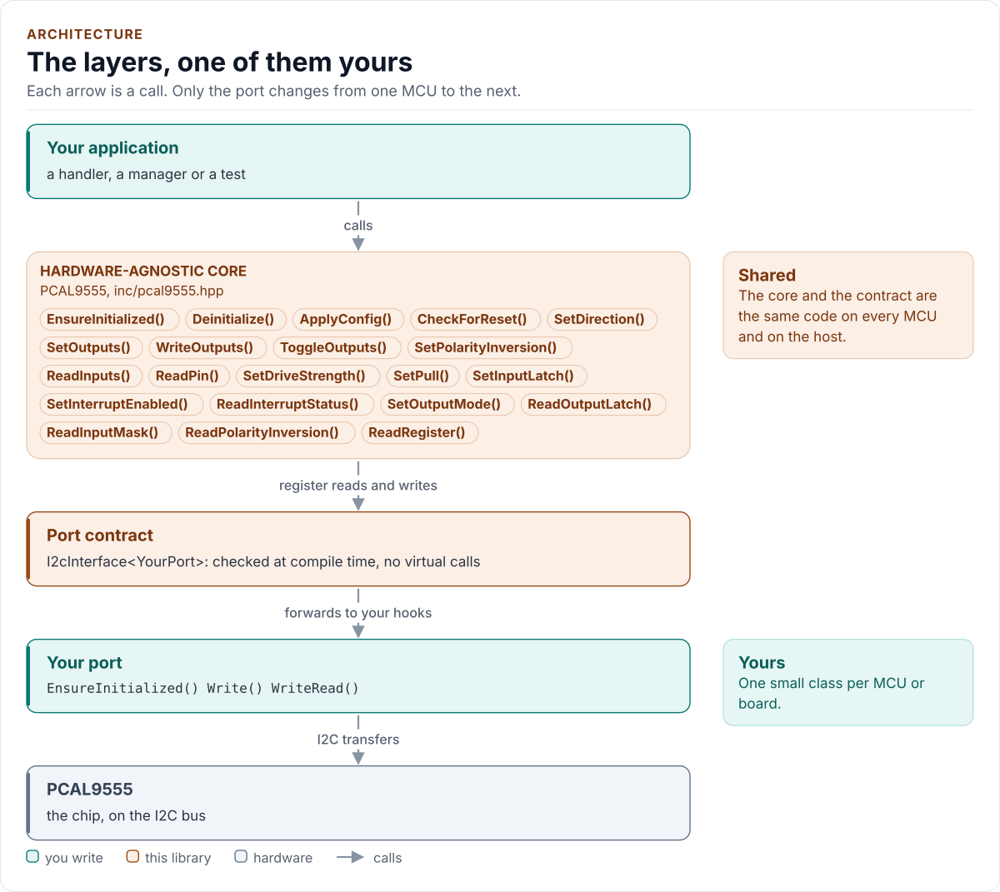
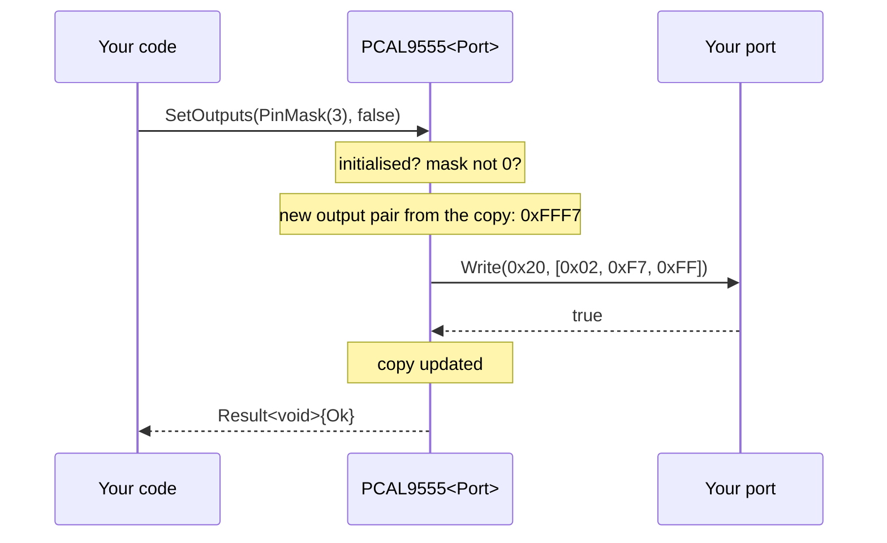

# Architecture

How the driver is built: three layers, one of them yours, and what happens in each when you change a pin.

<!-- generated: datasheet-refs -->
??? abstract "Datasheet sections this page relies on"

    From NXP PCAL9555A Rev. 2:

    - Register pairs, pointer toggling and burst transfers: 7 Bus transactions; 7.1 Writing to the port registers; 7.2 Reading the port registers, [p. 14](https://www.nxp.com/docs/en/data-sheet/PCAL9555A.pdf#page=14)

    All of them, with the driver API for each: [Datasheet map](datasheet.md).
<!-- /generated -->

<!-- figure: driver-layers -->
<picture>
  <source media="(prefers-color-scheme: dark)" srcset="diagrams/driver-layers.dark.svg">
  
</picture>
<!-- /figure -->

## Layers

| Layer | Files | Owns |
| --- | --- | --- |
| Core | [`inc/pcal9555.hpp`](../inc/pcal9555.hpp), [`src/pcal9555.ipp`](../src/pcal9555.ipp) | Lifecycle, the copy of the registers, presence and identity checks, write order, errors |
| Types and registers | [`inc/pcal9555_types.hpp`](../inc/pcal9555_types.hpp), [`inc/pcal9555_registers.hpp`](../inc/pcal9555_registers.hpp) | `Error`, `Result<T>`, `Config`, `Validate()`, pin helpers; the register map |
| Port contract | [`inc/pcal9555_i2c_interface.hpp`](../inc/pcal9555_i2c_interface.hpp) | The CRTP base, the `I2cPort` concept, the register framing |
| Platform port | Your class | Bus bring-up and byte transfers, optionally logging |
| Kconfig layer | [`inc/pcal9555_kconfig.hpp`](../inc/pcal9555_kconfig.hpp) | Optional: a `Config` from ESP-IDF menuconfig |

## One call through the layers

## Design choices

- **CRTP, not virtual functions.** The port is a template parameter constrained by the `I2cPort` concept, so every
  call is resolved at compile time and a missing hook is a compile error that names it.
- **A copy of the registers.** The driver writes every register it owns at start-up and keeps what it wrote in its
  `Config`. A pin call computes the new pair from the copy and writes it once, instead of a read-modify-write; the
  copy is also what `EnsureInitialized()` writes again after `Deinitialize()`.
- **The variant is configured, not probed.** The data sheets do not say how a PCA9555 answers the Agile I/O
  command bytes, so writing to them on a guess could reach the wrong register. `Config::variant` names the part,
  and a start-up for a PCAL9555A reads before it writes.
- **No waits.** The chip has no conversion or reset time, so the port has no delay hook and every call is a fixed
  number of transfers.
- **One error type.** `Result<T>` carries a value and an `Error`; nothing throws and nothing returns a bare
  `bool`.
- **No heap, no exceptions, no RTTI, no `std::function`, no `printf`.** The driver is a header-only template with
  no mutable static state.

## Source map

| You want | Read |
| --- | --- |
| The public API | [`inc/pcal9555.hpp`](../inc/pcal9555.hpp) |
| How a call is implemented | [`src/pcal9555.ipp`](../src/pcal9555.ipp) |
| Register addresses and bits | [`inc/pcal9555_registers.hpp`](../inc/pcal9555_registers.hpp) |
| The port contract | [`inc/pcal9555_i2c_interface.hpp`](../inc/pcal9555_i2c_interface.hpp) |

Next: [Contract](contract.md).
