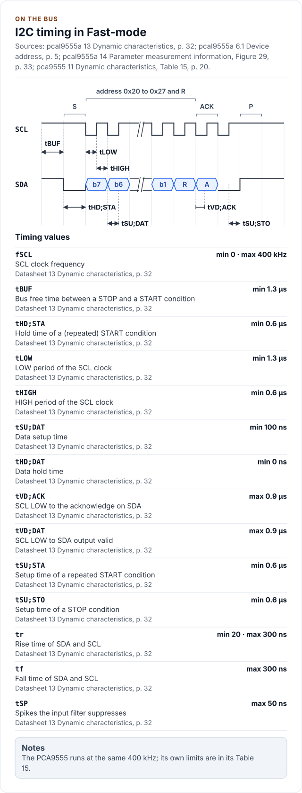
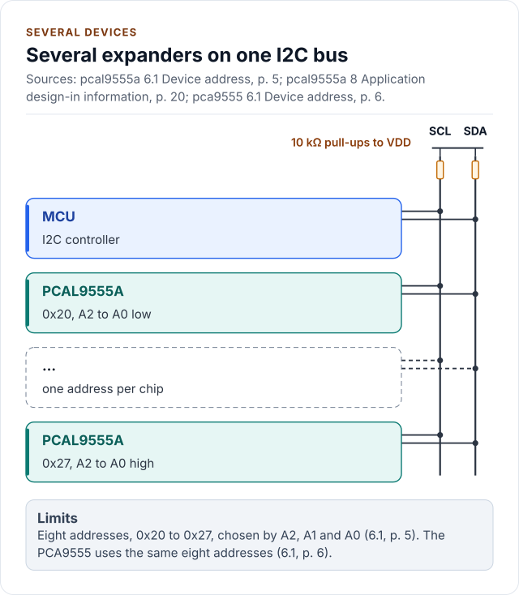

# On the bus

What the PCAL9555A (and the PCA9555) needs from the I2C bus, signal by signal, with every time and rate taken from
the data sheet. The connections are on the [Hardware](hardware.md) page and the register transfers in section 7 of
the data sheet; this page is the waveform under them.

## I2C timing

The PCAL9555A runs at Standard-mode and Fast-mode, up to 400 kHz (`kMaxClockHz`). SDA changes while SCL is LOW and
is read while SCL is HIGH; the address byte is `0 1 0 0 A2 A1 A0` and the R/W bit (figure 4). The figure draws
Figure 29 of the data sheet with the Fast-mode values of Table 33. Figure 13 pulls SCL, SDA and INT up to VDD with
10 kΩ each.

<!-- figure: i2c-timing -->
<picture>
  <source media="(prefers-color-scheme: dark)" srcset="diagrams/i2c-timing.dark.svg">
  
</picture>
<!-- /figure -->

## Several devices

The pins A2, A1 and A0 select one of eight addresses, `0x20` to `0x27` (section 6.1), so up to eight expanders share
one bus; the PCA9555 uses the same addresses. Tie each address pin HIGH or LOW.

<!-- figure: i2c-topology -->
<picture>
  <source media="(prefers-color-scheme: dark)" srcset="diagrams/i2c-topology.dark.svg">
  
</picture>
<!-- /figure -->

## How these figures are made

Each figure is a model in `docs/model/` (`i2c-timing.timing.yml` and `i2c-topology.topology.yml`) that cites the
data sheet section and page of every number; `kokeb-docs figures` draws it and the build fails on a number without a
citation. The values table under the waveform is also written as `docs/diagrams/i2c-timing.table.html`.
