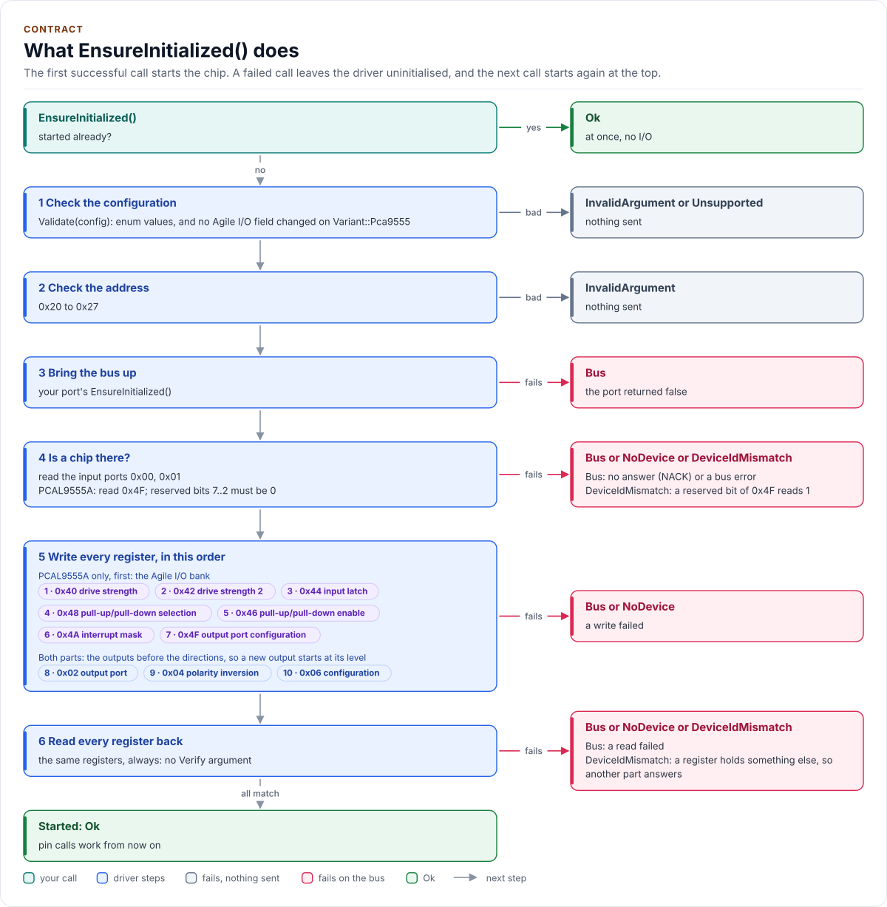

# Contract

What the PCAL9555 driver promises, what it needs, and the rules a caller follows.

<!-- generated: datasheet-refs -->
??? abstract "Datasheet sections this page relies on"

    From NXP PCAL9555A Rev. 2:

    - Power-up value of every register: Table 4 Command byte (power-up default), [p. 6](https://www.nxp.com/docs/en/data-sheet/PCAL9555A.pdf#page=6)

    All of them, with the driver API for each: [Datasheet map](datasheet.md).
<!-- /generated -->

The driver inherits the [Kokeb Labs driver contract](https://github.com/kokeb-labs/.github/blob/main/standards/driver.md);
this page states only what is specific to it. A change to anything here is a breaking change, listed under
**Breaking** in the [changelog](changelog.md).

## Promises

- The constructor is `noexcept`, stores the port, the address and the `Config`, does no I/O and cannot fail.
- `EnsureInitialized()` is the only start-up call. Its first call validates the stored `Config` and the address
  (no I/O when either is wrong), brings the bus up, checks that a part answers (and, for a PCAL9555A, that the
  reserved bits of 0x4F read 0), writes the identity pattern 0x55AA to the polarity inversion pair and reads it
  back, writes every register the driver owns and reads each back. On any failure the
  driver stays uninitialised and the next call starts again from the beginning. Once it has succeeded it returns
  `Ok` at once with no I/O.
- Every call that touches the chip returns `Error::NotInitialized` before `EnsureInitialized()` succeeds. No call
  starts, resets or reconfigures the chip as a side effect.
- `ApplyConfig()` before the start only stores the configuration; while running it writes every register and
  reads each back.
- A pin call makes only the transfers the data sheet needs; any read-back is opt-in, per call. Two checks are not
  opt-in, because the chip loses state on its own: `SetDirection()`, `ApplyConfig()`, `CheckForReset()` and a setter
  about to rewrite the register the reset check reads first read that register (`DeviceReset` when it holds its
  power-up value, section 6.4), and `SetDirection()` writes 0x4F (PCAL9555A) and the output pair before the
  configuration pair (section 6.2.12). On a PCAL9555A with an unmasked input, `ReadInputs()` and `ReadPin()` read the
  interrupt status pair before the inputs clear it (sections 6.2.11, 6.5). With
  `Verify::ReadBack` as its last argument (`Verify::None` by default), a setter reads its write back, and a register
  that did not keep its value returns `Error::WriteMismatch`: the call then never reports success for a write the
  chip acknowledged but lost. `GetConfig()` then holds what was asked for, so repeating an absolute call resends it
  (after `ToggleOutputs()`, resend with `WriteOutputs(GetConfig().output_high_mask)`); `ReadOutputLatch()`,
  `ReadInputMask()` and `ReadPolarityInversion()` read what the chip holds. `EnsureInitialized()` and
  `ApplyConfig()` always read every register back.
- Every port failure propagates, as `Error::NoDevice` when the port's optional `GetLastFailure()` reports an
  address NACK and as `Error::Bus` otherwise; no call returns a stale or zero value after a failed read. After
  `WriteMismatch` the copy holds what was asked for, for each register pair that was sent. After a write that
  failed with `Bus` (its bytes may have arrived) the copy holds the riskier of the old and the asked value (an
  output rather than an input, the written level, the stronger drive, push-pull; the written value elsewhere) and
  the register is unknown: no call builds on it before reading it from the chip, and the reset check never reads
  it. A read of it at its power-up value is `DeviceReset` (falsely, once, when the failed write's old or new value
  was the power-up value; `EnsureInitialized()` recovers); any other value is adopted. After `NoDevice` (an
  address NACK: nothing arrived) the copy is unchanged. After a failed `ApplyConfig()` the registers written
  before the failure hold the new values, the one that failed is unknown, and the rest keep the old ones.
- `ReadRegister()` is one read with no retry. `GetLastInputs()`, `GetLastOutput()`, `GetLatchedInterrupts()` and
  `ClearLatchedInterrupts()` do no I/O. Every interrupt status read is ORed into the latch, which only
  `ClearLatchedInterrupts()` empties.
- No transfer is empty: every one starts with the command byte, and the driver sends only command bytes the
  configured part implements.
- Every call is a bounded number of transfers (at most 24, the PCAL9555A start-up); the driver never waits or
  polls.
- `Config{}` equals the power-up value of every register (PCAL9555A data sheet table 4).
- On a driver configured for the PCA9555 (`Variant::Pca9555`), every Agile I/O call returns `Unsupported` and
  sends nothing, and `Validate()` refuses an Agile I/O field that differs from its power-up value.
- A missing `Log()` logs nothing; a missing `GetLastFailure()` makes every failed transfer `Bus`. A port that does
  not satisfy `I2cPort` (exact hook types, `noexcept`, `bool`), or an optional hook declared with another
  signature, is a compile error.
- `Deinitialize()` makes every pin a high-impedance input, the power-up direction: the chip drives nothing.

<!-- figure: start-up -->
<picture>
  <source media="(prefers-color-scheme: dark)" srcset="diagrams/start-up.dark.svg">
  
</picture>
<!-- /figure -->

## Depends on

| Dependency | Version | Why |
| --- | --- | --- |
| A C++20 compiler | GCC 10, Clang 13 or later | Concepts constrain the port |
| CMake | 3.16 or later | Generates `pcal9555_version.h` |
| Your port | | The I2C bus and optionally logging ([Porting](porting.md)) |

Nothing else: no RTOS, no SDK, no other repository of the org.

## Threading

The driver is not thread-safe and takes no lock. Use each driver object from one task at a time, or guard every
call on it with one mutex; the layer that owns the driver owns that lock, and the bus lock when several chips
share a bus. Nothing may run in an ISR: every call blocks for a bus transfer. When INT falls, signal a task and
let it call the driver. Separate objects share no state.

## Errors

`pcal9555::Error` inside `pcal9555::Result<T>`. Values 0 to 9 are the shared base set. The chip has no timed
operation, CRC, busy state or fault flag, so four base values are never returned. The chip-specific values
report a lost write (`WriteMismatch`), an absent chip (`NoDevice`) and a power-on reset (`DeviceReset`).

| `Error` | Value | Returned when |
| --- | --- | --- |
| `Ok` | 0 | The call succeeded |
| `NotInitialized` | 1 | `EnsureInitialized()` has not succeeded, or `Deinitialize()` ran since, or a call returned `DeviceReset` |
| `InvalidArgument` | 2 | A `Config` field or argument is not an enumerator, a mask is 0, a pin is above 15, the address is outside 0x20 to 0x27, or `ApplyConfig()` changes the variant of a running driver; nothing was sent |
| `Bus` | 3 | A port hook returned `false` and the port did not report an address NACK: a bus error, a command byte the part refuses, or (with a port without `GetLastFailure()`) no chip at the address |
| `Timeout` | 4 | Not returned by this driver |
| `DeviceIdMismatch` | 5 | At start-up: a register read back differently from what `EnsureInitialized()` wrote, or a reserved bit of 0x4F read 1 on a PCAL9555A: another part answers at the address |
| `Crc` | 6 | Not returned by this driver |
| `Busy` | 7 | Not returned by this driver |
| `DeviceFault` | 8 | Not returned by this driver |
| `Unsupported` | 9 | An Agile I/O call, or an Agile I/O `Config` field, on a driver configured for the PCA9555 |
| `WriteMismatch` | 16 | After the start, a register read back differently from what a setter or `ApplyConfig()` just wrote: the chip acknowledged the write and lost it (setters only with `Verify::ReadBack`) |
| `NoDevice` | 17 | Any call that makes a transfer, when the port's `GetLastFailure()` reports that nothing acknowledged the address: no chip, or an unpowered one |
| `DeviceReset` | 18 | `CheckForReset()`, `SetDirection()`, `ApplyConfig()`, or a setter about to rewrite the register the reset check reads, found that register at its power-up value while the copy says otherwise: a power-on reset (or a dropped write to it). Nothing was written; the driver is uninitialised |

The [API guide](api-guide.md#handle-errors) says what to do about each.

## Memory

No heap, no exceptions, no RTTI, no `std::function`, no `std::string`, no `printf` and no static mutable state. A
driver object holds a reference to the port, the address, a `Config` (the copy of the registers), the last
input and output values read, the interrupt latch, the set of registers whose last write failed, and a flag:
56 bytes on a 64-bit host, less on a 32-bit MCU.
The largest stack buffer is 3 bytes (a register pair and its command byte).

## Platform

Platform-free: the same code runs on any target with a C++20 compiler, including the host tests. The ESP-IDF port
in [`examples/esp32`](examples.md) is an example, not part of the driver.

## Deviations from the standard

| Rule (standards/driver.md) | Here | Why |
| --- | --- | --- |
| Start-up resets the chip (hardware reset if a pin hook exists, else software reset) | No reset: every register the driver owns is written instead | Neither part has a reset pin or a software reset; writing every register gives the same known state, whatever a previous run left |
| A setter updates the driver's copy only after the chip accepted the change (KB-CPP-120) | After a write that failed with `Bus`, the copy holds the riskier of the old and the asked value, marked unknown, and is read from the chip before anything is built on it | A failed transfer can still have delivered its bytes (a NACK or a lost ACK after them), so the old value is no safer a guess than the new one; the riskier one (an output, the written level, the stronger drive, push-pull) never understates what the pins may be doing, and the read before reuse means no write is computed from either guess |
| Start-up reads and checks the chip ID before applying the configuration | Presence by reading the input ports; identity by writing a test pattern to the polarity inversion pair and reading it back, then reading every written register back (and the reserved bits of 0x4F on a PCAL9555A) | The parts have no ID register; the input ports hold pin levels, and the other registers' power-up values are lost after a warm start, so only a read-back of known values identifies the part. The pattern goes to the one pair that changes no pin, so nothing is driven before the identity is confirmed |
