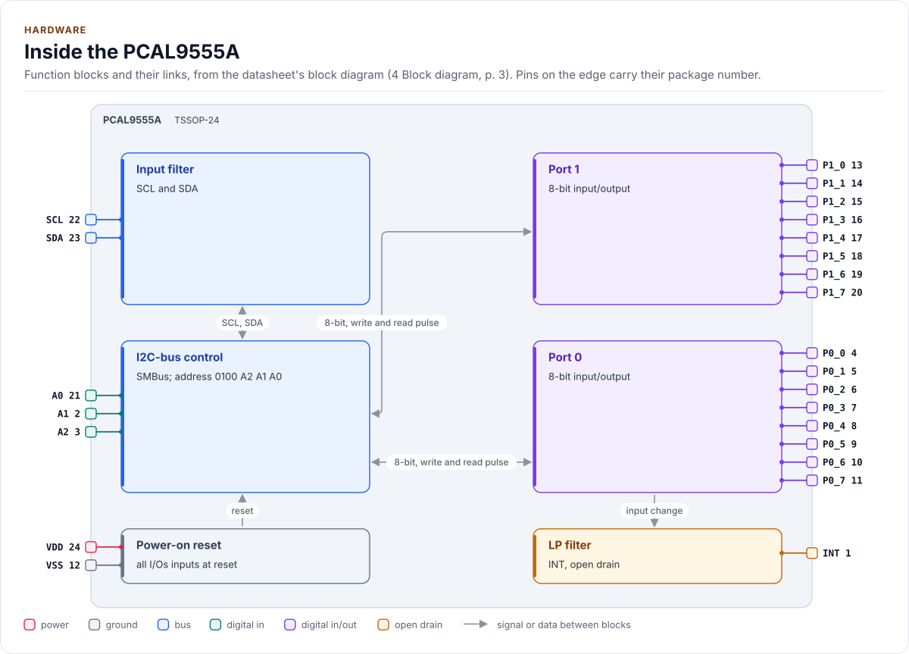
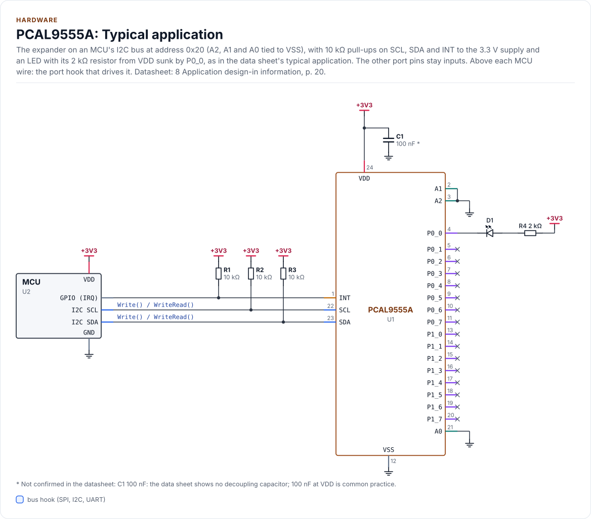
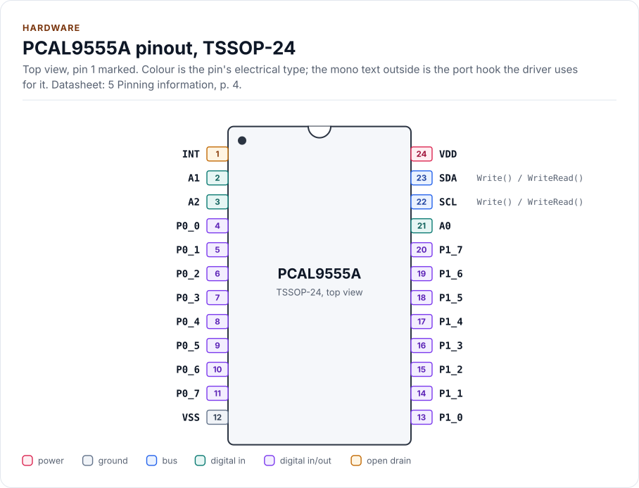
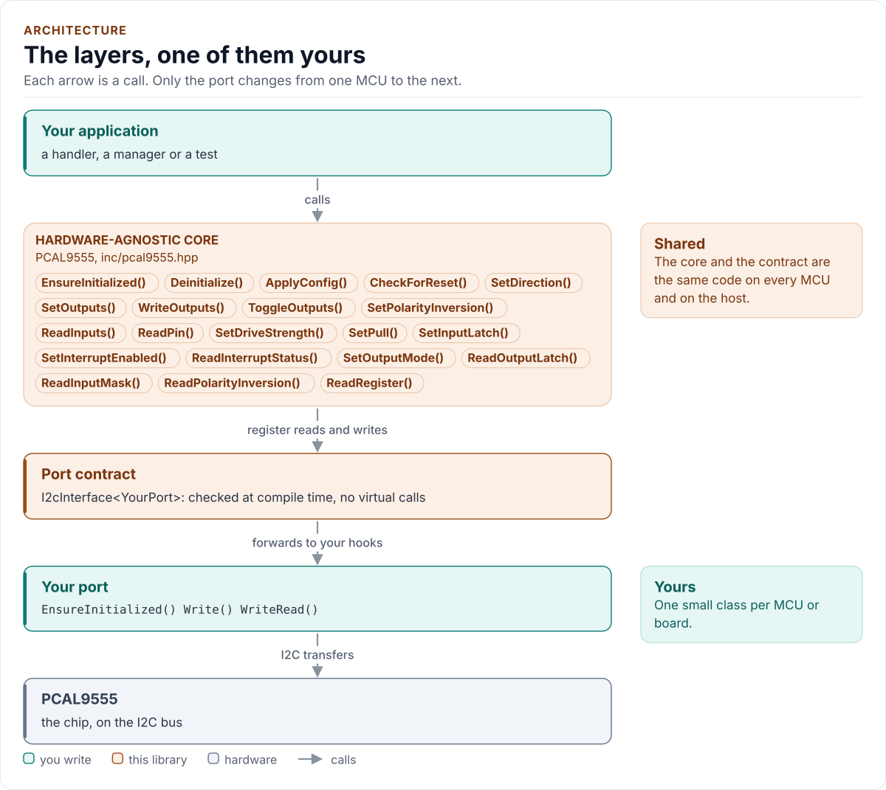
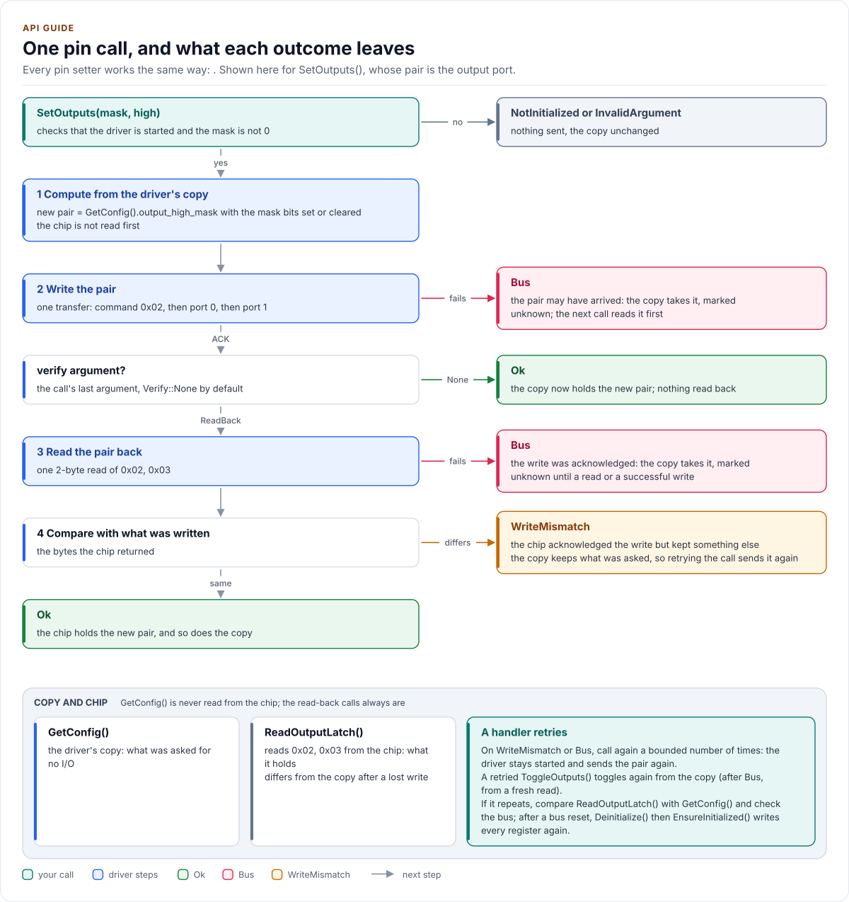
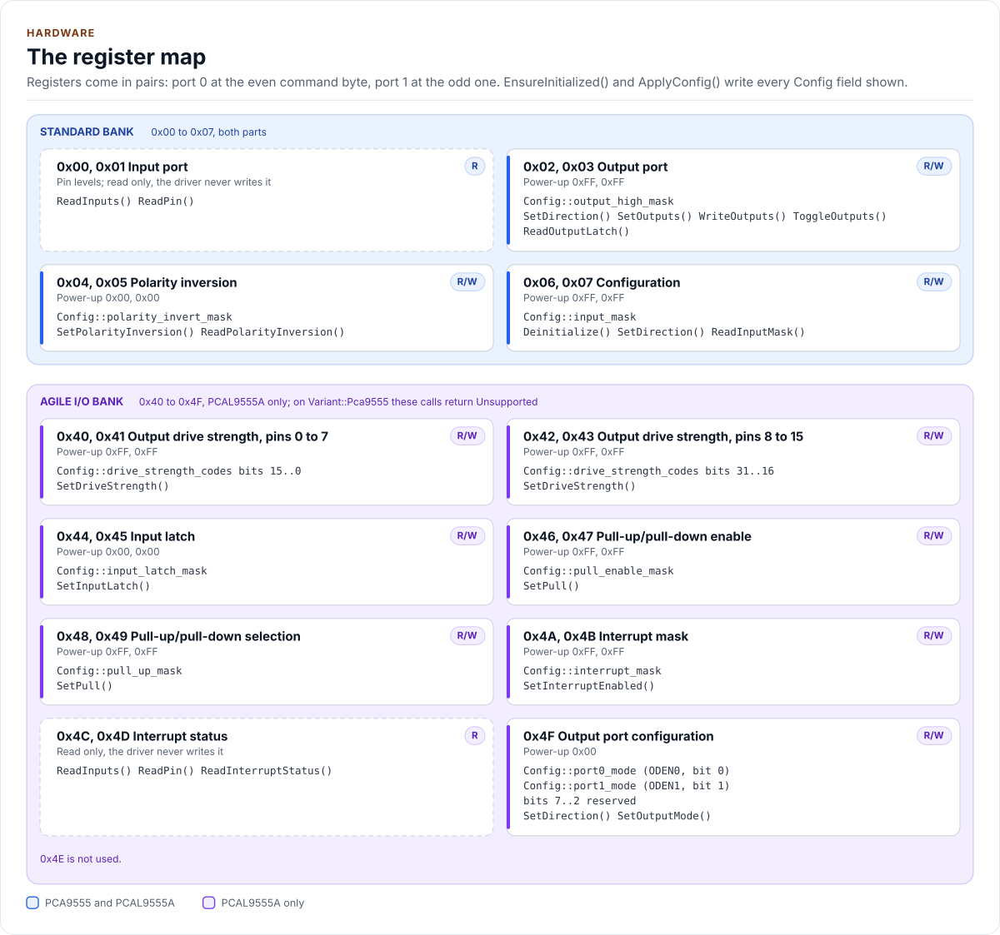
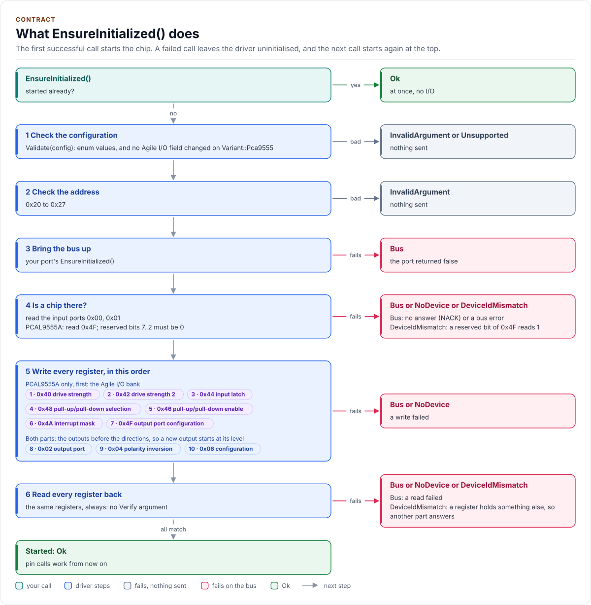

# Figures

<!-- Written by kokeb-docs figures from docs/diagrams/figures/*.py. Do not edit by hand. -->

Every figure on this site is drawn by a Python module from facts extracted from the code, so it is rebuilt,
not redrawn, when the code changes. CI runs `kokeb-docs figures --check` and fails when a
committed figure no longer matches the code. Each figure below lists the files it is drawn from.

## Inside the PCAL9555A

<!-- figure: chip-blocks -->
<picture>
  <source media="(prefers-color-scheme: dark)" srcset="chip-blocks.dark.svg">
  
</picture>
<!-- /figure -->

Hardware description: [`docs/hardware.yml`](../hardware.yml)

Drawn from:

- [`docs/hardware.yml`](../hardware.yml)
- [`inc/pcal9555_i2c_interface.hpp`](../../inc/pcal9555_i2c_interface.hpp)

## PCAL9555A: Typical application

<!-- figure: chip-circuit-typical -->
<picture>
  <source media="(prefers-color-scheme: dark)" srcset="chip-circuit-typical.dark.svg">
  
</picture>
<!-- /figure -->

Hardware description: [`docs/hardware.yml`](../hardware.yml)

Drawn from:

- [`docs/hardware.yml`](../hardware.yml)
- [`inc/pcal9555_i2c_interface.hpp`](../../inc/pcal9555_i2c_interface.hpp)

## PCAL9555A pinout, TSSOP-24

<!-- figure: chip-pinout -->
<picture>
  <source media="(prefers-color-scheme: dark)" srcset="chip-pinout.dark.svg">
  
</picture>
<!-- /figure -->

Hardware description: [`docs/hardware.yml`](../hardware.yml)

Drawn from:

- [`docs/hardware.yml`](../hardware.yml)
- [`inc/pcal9555_i2c_interface.hpp`](../../inc/pcal9555_i2c_interface.hpp)

## The layers, one of them yours

<!-- figure: driver-layers -->
<picture>
  <source media="(prefers-color-scheme: dark)" srcset="driver-layers.dark.svg">
  
</picture>
<!-- /figure -->

Figure module: [`docs/diagrams/figures/driver-layers.py`](../../docs/diagrams/figures/driver-layers.py)

Drawn from:

- `public calls` in [`inc/pcal9555.hpp`](../../inc/pcal9555.hpp)
- `I2cInterface` in [`inc/pcal9555_i2c_interface.hpp`](../../inc/pcal9555_i2c_interface.hpp)

## One pin call, and what each outcome leaves

<!-- figure: pin-write -->
<picture>
  <source media="(prefers-color-scheme: dark)" srcset="pin-write.dark.svg">
  
</picture>
<!-- /figure -->

Figure module: [`docs/diagrams/figures/pin-write.py`](../../docs/diagrams/figures/pin-write.py)

Drawn from:

- `SetOutputs, writeMask, storeMask, writePairChecked, ReadOutputLatch` in [`src/pcal9555.ipp`](../../src/pcal9555.ipp)
- `Verify` in [`inc/pcal9555_types.hpp`](../../inc/pcal9555_types.hpp)
- `kOutputPort0` in [`inc/pcal9555_registers.hpp`](../../inc/pcal9555_registers.hpp)

## The register map

<!-- figure: register-map -->
<picture>
  <source media="(prefers-color-scheme: dark)" srcset="register-map.dark.svg">
  
</picture>
<!-- /figure -->

Figure module: [`docs/diagrams/figures/register-map.py`](../../docs/diagrams/figures/register-map.py)

Drawn from:

- `register constants` in [`inc/pcal9555_registers.hpp`](../../inc/pcal9555_registers.hpp)
- `StandardPairs, AgilePairs, OutputPortConfig` in [`inc/pcal9555.hpp`](../../inc/pcal9555.hpp)
- `calls` in [`src/pcal9555.ipp`](../../src/pcal9555.ipp)

## What EnsureInitialized() does

<!-- figure: start-up -->
<picture>
  <source media="(prefers-color-scheme: dark)" srcset="start-up.dark.svg">
  
</picture>
<!-- /figure -->

Figure module: [`docs/diagrams/figures/start-up.py`](../../docs/diagrams/figures/start-up.py)

Drawn from:

- `EnsureInitialized, initialize, checkPresence, writeAll, verifyAll` in [`src/pcal9555.ipp`](../../src/pcal9555.ipp)
- `StandardPairs, AgilePairs` in [`inc/pcal9555.hpp`](../../inc/pcal9555.hpp)
- `Validate, kMinI2cAddress, kMaxI2cAddress` in [`inc/pcal9555_types.hpp`](../../inc/pcal9555_types.hpp)
- `register constants` in [`inc/pcal9555_registers.hpp`](../../inc/pcal9555_registers.hpp)
