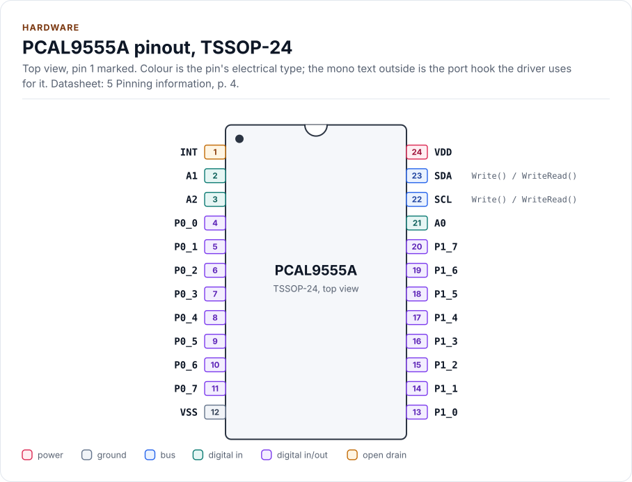
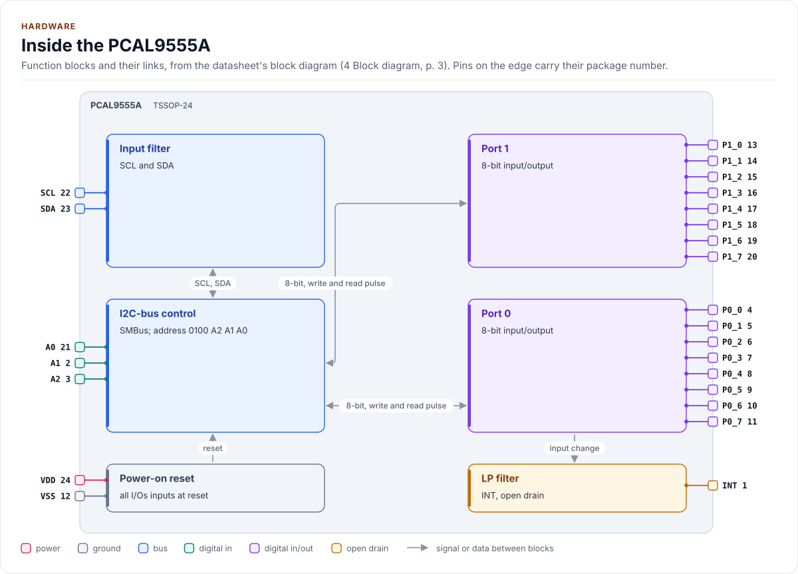
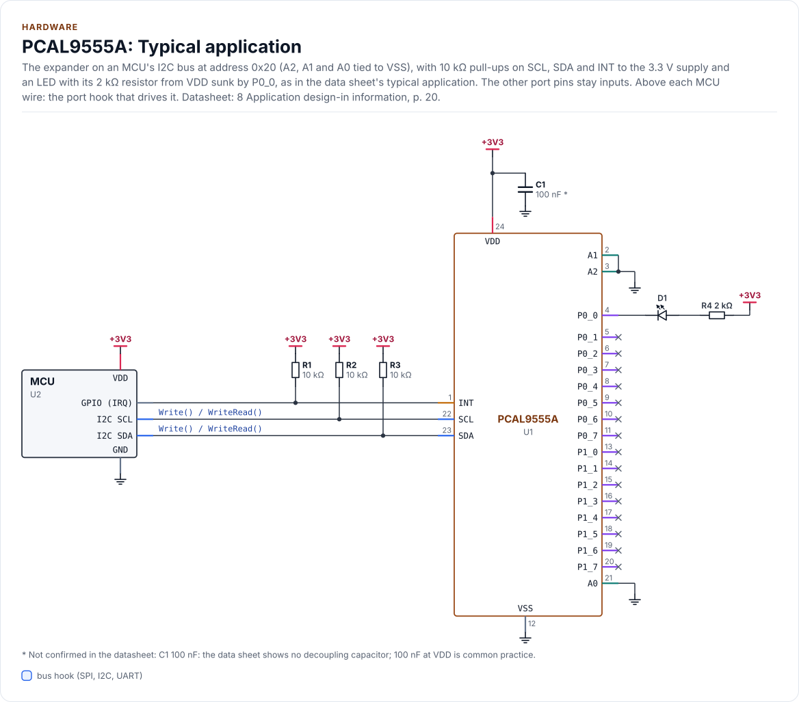

# Hardware

The PCA9555's and PCAL9555A's pins, addresses, bus transactions, interrupt and power, as the driver uses them.

<!-- generated: datasheet-refs -->
??? abstract "Datasheet sections this page relies on"

    - Pins and package: NXP PCAL9555A Rev. 2, 5 Pinning information, [p. 4](https://www.nxp.com/docs/en/data-sheet/PCAL9555A.pdf#page=4)
    - Address pins and the 7-bit address: NXP PCAL9555A Rev. 2, 6.1 Device address, [p. 5](https://www.nxp.com/docs/en/data-sheet/PCAL9555A.pdf#page=5)
    - Registers and command bytes: NXP PCAL9555A Rev. 2, 6.2 Registers; 6.2.1 Pointer register and command byte, [p. 5](https://www.nxp.com/docs/en/data-sheet/PCAL9555A.pdf#page=5)
    - Input, output, polarity inversion and configuration registers: NXP PCAL9555A Rev. 2, 6.2.2 to 6.2.5 Input port, Output port, Polarity inversion and Configuration register pairs, [p. 7](https://www.nxp.com/docs/en/data-sheet/PCAL9555A.pdf#page=7)
    - Interrupt status: NXP PCAL9555A Rev. 2, 6.2.11 Interrupt status register pair, [p. 12](https://www.nxp.com/docs/en/data-sheet/PCAL9555A.pdf#page=12)
    - Power-on reset: NXP PCAL9555A Rev. 2, 6.4 Power-on reset; 8.3 Power-on reset requirements, [p. 13](https://www.nxp.com/docs/en/data-sheet/PCAL9555A.pdf#page=13)
    - Interrupt output (INT): NXP PCAL9555A Rev. 2, 6.5 Interrupt output, [p. 14](https://www.nxp.com/docs/en/data-sheet/PCAL9555A.pdf#page=14)
    - Register pairs, pointer toggling and burst transfers: NXP PCAL9555A Rev. 2, 7 Bus transactions; 7.1 Writing to the port registers; 7.2 Reading the port registers, [p. 14](https://www.nxp.com/docs/en/data-sheet/PCAL9555A.pdf#page=14)
    - Application circuit: NXP PCAL9555A Rev. 2, 8 Application design-in information, [p. 20](https://www.nxp.com/docs/en/data-sheet/PCAL9555A.pdf#page=20)
    - Supply range and limiting values: NXP PCAL9555A Rev. 2, 9 Limiting values; 10 Recommended operating conditions, [p. 25](https://www.nxp.com/docs/en/data-sheet/PCAL9555A.pdf#page=25)
    - Pull resistor value, sink current and logic levels: NXP PCAL9555A Rev. 2, 12 Static characteristics, [p. 26](https://www.nxp.com/docs/en/data-sheet/PCAL9555A.pdf#page=26)
    - I2C timing and INT timing: NXP PCAL9555A Rev. 2, 13 Dynamic characteristics, [p. 32](https://www.nxp.com/docs/en/data-sheet/PCAL9555A.pdf#page=32)
    - Pins and package: NXP PCA9555 Rev. 10, 5 Pinning information, [p. 3](https://www.nxp.com/docs/en/data-sheet/PCA9555.pdf#page=3)
    - Address pins and the 7-bit address: NXP PCA9555 Rev. 10, 6.1 Device address, [p. 6](https://www.nxp.com/docs/en/data-sheet/PCA9555.pdf#page=6)
    - Registers, command bytes and power-up values: NXP PCA9555 Rev. 10, 6.2 Registers; 6.2.1 Command byte (Table 4), [p. 6](https://www.nxp.com/docs/en/data-sheet/PCA9555.pdf#page=6)
    - Power-on reset: NXP PCA9555 Rev. 10, 6.3 Power-on reset, [p. 8](https://www.nxp.com/docs/en/data-sheet/PCA9555.pdf#page=8)
    - Fixed weak pull-up on inputs: NXP PCA9555 Rev. 10, 6.4 I/O port, [p. 8](https://www.nxp.com/docs/en/data-sheet/PCA9555.pdf#page=8)
    - Register pairs, pointer toggling and burst transfers: NXP PCA9555 Rev. 10, 6.5 Bus transactions; 6.5.1 Writing to the port registers; 6.5.2 Reading the port registers, [p. 9](https://www.nxp.com/docs/en/data-sheet/PCA9555.pdf#page=9)
    - Interrupt output (INT), no mask or status: NXP PCA9555 Rev. 10, 6.5.3 Interrupt output, [p. 14](https://www.nxp.com/docs/en/data-sheet/PCA9555.pdf#page=14)
    - Application circuit: NXP PCA9555 Rev. 10, 8 Application design-in information, [p. 16](https://www.nxp.com/docs/en/data-sheet/PCA9555.pdf#page=16)
    - Supply range, sink current and logic levels: NXP PCA9555 Rev. 10, 10 Static characteristics, [p. 18](https://www.nxp.com/docs/en/data-sheet/PCA9555.pdf#page=18)
    - I2C timing and INT timing: NXP PCA9555 Rev. 10, 11 Dynamic characteristics, [p. 20](https://www.nxp.com/docs/en/data-sheet/PCA9555.pdf#page=20)

    All of them, with the driver API for each: [Datasheet map](datasheet.md).
<!-- /generated -->

Every value on this page comes from the [PCAL9555A data sheet](https://www.nxp.com/docs/en/data-sheet/PCAL9555A.pdf)
(NXP, Rev. 2, 19 December 2014) and the [PCA9555 data sheet](https://www.nxp.com/docs/en/data-sheet/PCA9555.pdf)
(NXP, Rev. 10, 8 November 2017); section and table numbers refer to the PCAL9555A one unless stated. The driver is
**not verified on hardware** yet: the values are the data sheets', and the driver's behaviour against them is
tested on the protocol model only.

## Pins

TSSOP24 pin numbers, the same on both parts (table 3); the HWQFN24 package has other numbers and an exposed pad
that is connected to VSS.

<!-- figure: chip-pinout -->
<picture>
  <source media="(prefers-color-scheme: dark)" srcset="diagrams/chip-pinout.dark.svg">
  
</picture>
<!-- /figure -->

<!-- generated: chip-pins -->
TSSOP-24, 24 pins (5 Pinning information, [p. 4](https://www.nxp.com/docs/en/data-sheet/PCAL9555A.pdf#page=4)).

| Pin | Name | Type (domain) | Function | Driver hook | If unused | Datasheet |
| --- | --- | --- | --- | --- | --- | --- |
| 1 | `INT` | open drain (VDD) | Interrupt output, active low; pull-up to VDD, to an MCU input | - | Leave open | 6.5, [p. 14](https://www.nxp.com/docs/en/data-sheet/PCAL9555A.pdf#page=14) |
| 2 | `A1` | digital in (VDD) | Address input 1; connect directly to VDD or VSS | - | Never open | 6.1, [p. 5](https://www.nxp.com/docs/en/data-sheet/PCAL9555A.pdf#page=5) |
| 3 | `A2` | digital in (VDD) | Address input 2; connect directly to VDD or VSS | - | Never open | 6.1, [p. 5](https://www.nxp.com/docs/en/data-sheet/PCAL9555A.pdf#page=5) |
| 4 | `P0_0` | digital in/out (VDD) | Port 0 bit 0, driver pin 0 | - | Input | 6.2.2 to 6.2.5, [p. 7](https://www.nxp.com/docs/en/data-sheet/PCAL9555A.pdf#page=7) |
| 5 | `P0_1` | digital in/out (VDD) | Port 0 bit 1, driver pin 1 | - | Input | 6.2.2 to 6.2.5, [p. 7](https://www.nxp.com/docs/en/data-sheet/PCAL9555A.pdf#page=7) |
| 6 | `P0_2` | digital in/out (VDD) | Port 0 bit 2, driver pin 2 | - | Input | 6.2.2 to 6.2.5, [p. 7](https://www.nxp.com/docs/en/data-sheet/PCAL9555A.pdf#page=7) |
| 7 | `P0_3` | digital in/out (VDD) | Port 0 bit 3, driver pin 3 | - | Input | 6.2.2 to 6.2.5, [p. 7](https://www.nxp.com/docs/en/data-sheet/PCAL9555A.pdf#page=7) |
| 8 | `P0_4` | digital in/out (VDD) | Port 0 bit 4, driver pin 4 | - | Input | 6.2.2 to 6.2.5, [p. 7](https://www.nxp.com/docs/en/data-sheet/PCAL9555A.pdf#page=7) |
| 9 | `P0_5` | digital in/out (VDD) | Port 0 bit 5, driver pin 5 | - | Input | 6.2.2 to 6.2.5, [p. 7](https://www.nxp.com/docs/en/data-sheet/PCAL9555A.pdf#page=7) |
| 10 | `P0_6` | digital in/out (VDD) | Port 0 bit 6, driver pin 6 | - | Input | 6.2.2 to 6.2.5, [p. 7](https://www.nxp.com/docs/en/data-sheet/PCAL9555A.pdf#page=7) |
| 11 | `P0_7` | digital in/out (VDD) | Port 0 bit 7, driver pin 7 | - | Input | 6.2.2 to 6.2.5, [p. 7](https://www.nxp.com/docs/en/data-sheet/PCAL9555A.pdf#page=7) |
| 12 | `VSS` | ground | Ground | - | - | 5, [p. 4](https://www.nxp.com/docs/en/data-sheet/PCAL9555A.pdf#page=4) |
| 13 | `P1_0` | digital in/out (VDD) | Port 1 bit 0, driver pin 8 | - | Input | 6.2.2 to 6.2.5, [p. 7](https://www.nxp.com/docs/en/data-sheet/PCAL9555A.pdf#page=7) |
| 14 | `P1_1` | digital in/out (VDD) | Port 1 bit 1, driver pin 9 | - | Input | 6.2.2 to 6.2.5, [p. 7](https://www.nxp.com/docs/en/data-sheet/PCAL9555A.pdf#page=7) |
| 15 | `P1_2` | digital in/out (VDD) | Port 1 bit 2, driver pin 10 | - | Input | 6.2.2 to 6.2.5, [p. 7](https://www.nxp.com/docs/en/data-sheet/PCAL9555A.pdf#page=7) |
| 16 | `P1_3` | digital in/out (VDD) | Port 1 bit 3, driver pin 11 | - | Input | 6.2.2 to 6.2.5, [p. 7](https://www.nxp.com/docs/en/data-sheet/PCAL9555A.pdf#page=7) |
| 17 | `P1_4` | digital in/out (VDD) | Port 1 bit 4, driver pin 12 | - | Input | 6.2.2 to 6.2.5, [p. 7](https://www.nxp.com/docs/en/data-sheet/PCAL9555A.pdf#page=7) |
| 18 | `P1_5` | digital in/out (VDD) | Port 1 bit 5, driver pin 13 | - | Input | 6.2.2 to 6.2.5, [p. 7](https://www.nxp.com/docs/en/data-sheet/PCAL9555A.pdf#page=7) |
| 19 | `P1_6` | digital in/out (VDD) | Port 1 bit 6, driver pin 14 | - | Input | 6.2.2 to 6.2.5, [p. 7](https://www.nxp.com/docs/en/data-sheet/PCAL9555A.pdf#page=7) |
| 20 | `P1_7` | digital in/out (VDD) | Port 1 bit 7, driver pin 15 | - | Input | 6.2.2 to 6.2.5, [p. 7](https://www.nxp.com/docs/en/data-sheet/PCAL9555A.pdf#page=7) |
| 21 | `A0` | digital in (VDD) | Address input 0; connect directly to VDD or VSS | - | Never open | 6.1, [p. 5](https://www.nxp.com/docs/en/data-sheet/PCAL9555A.pdf#page=5) |
| 22 | `SCL` | bus (VDD) | I2C clock, up to 400 kHz; pull-up to VDD | `Write() / WriteRead()` | - | 13, [p. 32](https://www.nxp.com/docs/en/data-sheet/PCAL9555A.pdf#page=32) |
| 23 | `SDA` | bus (VDD) | I2C data; pull-up to VDD | `Write() / WriteRead()` | - | 5, [p. 4](https://www.nxp.com/docs/en/data-sheet/PCAL9555A.pdf#page=4) |
| 24 | `VDD` | power (VDD) | Supply, 1.65 V to 5.5 V; sets the I2C and I/O levels | - | - | 10, [p. 25](https://www.nxp.com/docs/en/data-sheet/PCAL9555A.pdf#page=25) |

Source of this table and of the chip figures: [`docs/hardware.yml`](hardware.yml).
<!-- /generated -->

At power-up every I/O is an input with a weak (about 100 kΩ) pull-up to VDD, so unused pins do not float. On the
PCA9555 the pull-up is fixed (PCA9555 section 6.4); on the PCAL9555A it can be switched to a pull-down or off per
pin ([Agile I/O](agile-io.md#pull-resistors)). Neither part has a reset pin: the only reset is the power-on reset,
so the port has no GPIO hook. The pinout, the block diagram, the circuit and both tables are drawn from
[`docs/hardware.yml`](hardware.yml).

## Inside the chip

Figure 1 of the data sheet: SCL and SDA pass an input filter to the I2C-bus control, which moves 8 bits at a time
to each port; an input change on either port drives INT through a low-pass filter.

<!-- figure: chip-blocks -->
<picture>
  <source media="(prefers-color-scheme: dark)" srcset="diagrams/chip-blocks.dark.svg">
  
</picture>
<!-- /figure -->

## Typical application

Figure 13 of the data sheet, reduced to the bus, the interrupt and one output: 10 kΩ pull-ups on SCL, SDA and INT,
the address pins tied to VSS (address 0x20), and an LED with a 2 kΩ series resistor sunk by P0_0. The MCU and the
expander share the 3.3 V supply, which sets the I2C logic levels ([Power](#power)).

<!-- figure: chip-circuit-typical -->
<picture>
  <source media="(prefers-color-scheme: dark)" srcset="diagrams/chip-circuit-typical.dark.svg">
  
</picture>
<!-- /figure -->

<!-- generated: chip-parts -->
| Part | Kind | Value | Connects | Datasheet |
| --- | --- | --- | --- | --- |
| U2 | MCU | - | VDD: +3V3, GND: GND, SCL: SCL, SDA: SDA, IRQ: INT | 8, [p. 20](https://www.nxp.com/docs/en/data-sheet/PCAL9555A.pdf#page=20) |
| R1 | resistor | 10 kΩ | +3V3, INT | 8, [p. 20](https://www.nxp.com/docs/en/data-sheet/PCAL9555A.pdf#page=20) |
| R2 | resistor | 10 kΩ | +3V3, SCL | 8, [p. 20](https://www.nxp.com/docs/en/data-sheet/PCAL9555A.pdf#page=20) |
| R3 | resistor | 10 kΩ | +3V3, SDA | 8, [p. 20](https://www.nxp.com/docs/en/data-sheet/PCAL9555A.pdf#page=20) |
| C1 | capacitor | 100 nF (not confirmed: the data sheet shows no decoupling capacitor; 100 nF at VDD is common practice) | +3V3, GND | 8, [p. 20](https://www.nxp.com/docs/en/data-sheet/PCAL9555A.pdf#page=20) |
| R4 | resistor | 2 kΩ | +3V3, LED_A | 8, [p. 20](https://www.nxp.com/docs/en/data-sheet/PCAL9555A.pdf#page=20) |
| D1 | led | - | LED_A, P0_0 | 8, [p. 20](https://www.nxp.com/docs/en/data-sheet/PCAL9555A.pdf#page=20) |

Export a circuit for a schematic or PCB tool: `kokeb-docs hardware --kicad-netlist OUT.net --circuit typical`.
<!-- /generated -->

## Address

7-bit address `0100 A2 A1 A0` (section 6.1): `0x20` to `0x27`, eight chips per bus. `AddressFromPins(a2, a1, a0)`
computes it; `kI2cAddress` (and its older name `kDefaultI2cAddress`) is `0x20`. `EnsureInitialized()` rejects any
other address with `InvalidArgument` before it touches the bus.

## Registers

Table 4. The PCA9555 has the first eight registers; the PCAL9555A adds the Agile I/O bank. Pin n of the driver is
bit n of a 16-bit pair: port 0 in the even register (bits 7..0), port 1 in the odd one.

<!-- figure: register-map -->
<picture>
  <source media="(prefers-color-scheme: dark)" srcset="diagrams/register-map.dark.svg">
  
</picture>
<!-- /figure -->

| Command | Register | Access | Power-up | `Config` field |
| --- | --- | --- | --- | --- |
| 0x00, 0x01 | Input port 0, 1 | R | pin levels | (read by `ReadInputs()`, `ReadPin()`) |
| 0x02, 0x03 | Output port 0, 1 | R/W | 0xFF | `output_high_mask` |
| 0x04, 0x05 | Polarity inversion 0, 1 | R/W | 0x00 | `polarity_invert_mask` |
| 0x06, 0x07 | Configuration 0, 1 (1 = input) | R/W | 0xFF | `input_mask` |
| 0x40 to 0x43 | Output drive strength, 2 bits per pin | R/W | 0xFF | `drive_strength_codes` |
| 0x44, 0x45 | Input latch | R/W | 0x00 | `input_latch_mask` |
| 0x46, 0x47 | Pull-up/pull-down enable | R/W | 0xFF | `pull_enable_mask` |
| 0x48, 0x49 | Pull-up/pull-down selection (1 = up) | R/W | 0xFF | `pull_up_mask` |
| 0x4A, 0x4B | Interrupt mask (1 = masked) | R/W | 0xFF | `interrupt_mask` |
| 0x4C, 0x4D | Interrupt status | R | 0x00 | (read by `ReadInterruptStatus()`) |
| 0x4F | Output port configuration: ODEN0 (bit 0), ODEN1 (bit 1), bits 7..2 reserved | R/W | 0x00 | `port0_mode`, `port1_mode` |

Reading an output port register returns the output latch, not the pin. The input port registers reflect the pin
whether it is an input or an output. [`inc/pcal9555_registers.hpp`](../inc/pcal9555_registers.hpp) has the map as
the driver uses it.

## Bus transactions

Section 7. After the address byte the master sends a command byte, which sets the pointer. Each data byte then
goes to (or comes from) the pointed register, and the pointer moves to the **other register of the pair**: a
write of two bytes after command 0x02 sets output port 0, then output port 1. The pointer never moves on to the
next pair, so the driver moves at most one pair per transfer.

| Transfer | Bytes on the bus | Used by |
| --- | --- | --- |
| Write pair | START, address + W, command, port 0, port 1, STOP | Every setter, `ApplyConfig()`, `Deinitialize()` |
| Write one | START, address + W, 0x4F, value, STOP | `SetOutputMode()`, the 0x4F write of the start-up |
| Read pair | START, address + W, command, repeated START, address + R, port 0, port 1 (NACK), STOP | `ReadInputs()`, `ReadInterruptStatus()`, the read-backs |
| Read one | As above with one data byte | `ReadPin()`, the 0x4F reads |

| Call | Transfers | Clock time at 400 kHz |
| --- | --- | --- |
| A pin setter (`SetOutputs()`, `SetPolarityInversion()`, `SetInputLatch()`, `SetInterruptEnabled()`, `WriteOutputs()`, `ToggleOutputs()`) | 1 write pair (one read first when it rewrites the register the reset check reads and another register is off its power-up value) | 90 µs |
| `SetDirection()`, PCA9555 | 1 read (the reset check; none when the copy is all power-up values), 2 write pairs | 0.29 ms |
| `SetDirection()`, PCAL9555A | 1 read, 1 write (0x4F), 2 write pairs | 0.36 ms |
| `SetDirection(..., Direction::Input)` that leaves every pin an input | 1 write pair | 90 µs |
| `CheckForReset()` | 1 read pair (1 read for 0x4F; none when the copy is all power-up values; after a failed write, one read per unknown register when no other is left) | 113 µs |
| `SetPull()` | 2 write pairs (1 for `Pull::None`) | 180 µs |
| `SetDriveStrength()` | 2 write pairs | 180 µs |
| `ReadInputs()`, `ReadInterruptStatus()` | 1 read pair (`ReadInputs()`: 2 on a PCAL9555A with an unmasked input, the interrupt status first) | 113 µs (226 µs) |
| `ReadPin()` | 1 read (plus the interrupt status pair, as `ReadInputs()`) | 90 µs (203 µs) |
| `EnsureInitialized()`, PCA9555 | 1 read, 3 writes, 3 read-backs | 0.72 ms |
| `EnsureInitialized()`, PCAL9555A | 2 reads, 10 writes, 10 read-backs | 2.2 ms |
| `ApplyConfig()` while running | the reset check, then as `EnsureInitialized()` without the presence reads | 0.72 ms / 2.1 ms |

With `Verify::ReadBack` (the last argument of a setter; `Verify::None` by default), add one read pair (113 µs)
after each write pair and one read (90 µs) after the write of `SetOutputMode()` (`SetDirection()`: one read pair
after the configuration pair). The times are derived (9 clocks
per byte), not measured, and leave out START, STOP and your port's overhead.

### Unimplemented command bytes

Neither data sheet says how a part answers a command byte it does not implement, such as 0x4F on a PCA9555. The
driver assumes a NACK and therefore never auto-detects the part: `Config::variant` names it. Configured as a
PCAL9555A on a PCA9555 that NACKs, `EnsureInitialized()` fails with `Bus` at the 0x4F read, before any write. If a
part instead used only the low three bits of the command, 0x4F would read configuration port 1, which is 0xFF after
power-up; the reserved-bits check then fails with `DeviceIdMismatch`, still before any write. **Not verified on
hardware**: bench step 4 in [Troubleshooting](troubleshooting.md#bench-checks) checks it.

## Timing

Neither part needs a wait between transfers: there is no conversion, no reset sequence and no programming time,
so the driver never waits and the port has no `DelayUs()` hook.

| Symbol | Parameter | PCAL9555A | PCA9555 |
| --- | --- | --- | --- |
| f_SCL | I2C clock | 0 to 400 kHz | 0 to 400 kHz |
| t_v(Q) | SCL to output valid, after the data byte's ACK | 400 ns max | 200 ns max |
| t_v(INT) | Input change to INT valid | 1 µs max | 4 µs max |
| t_rst(INT) | SCL (ACK of the input read) to INT released | 1 µs max | 4 µs max |

## Interrupt

Section 6.5. An input that changes raises INT; reading the input port of that pin releases it, as does the pin
returning to its old level before the read. A pin configured as an output never raises INT, and turning an output
into an input can raise a false interrupt when its level differs from the input register.

| | PCA9555 | PCAL9555A |
| --- | --- | --- |
| Which pins raise INT | Every input, always | Inputs whose interrupt mask bit is 0; all masked at power-up |
| Which pin raised it | Compare `ReadInputs()` with the last value | `ReadInterruptStatus()` (masked pins read 0); the status does not clear INT |
| Short pulses | Lost if the pin returns before the read | Kept with the input latch: the input register holds the level that raised INT until it is read |

Reading one port (`ReadPin()`) releases only that port's interrupt; `ReadInputs()` reads both. The read also clears
the interrupt status bits of the port (section 6.2.11), so on a PCAL9555A with an unmasked input the driver reads
the status pair into `GetLatchedInterrupts()` first. INT is open-drain,
active low: pull it up to the MCU's VDD and wire it to an MCU input. The driver never runs in the ISR: signal a
task, which then calls the driver ([API guide](api-guide.md#handle-an-interrupt)).

## Power

| Parameter | PCAL9555A | PCA9555 |
| --- | --- | --- |
| Supply | 1.65 V to 5.5 V | 2.3 V to 5.5 V |
| I/O | 5.5 V tolerant | 5.5 V tolerant |
| Output sink current per pin | 25 mA (drive strength 11b) | 8 mA min at V_OL = 0.5 V |
| Total ground current | 200 mA (limiting value) | 200 mA (limiting value) |
| Total supply current (sourced by the I/Os) | 160 mA (limiting value) | 160 mA |

- The supply sets the I2C logic levels: run the expander from the MCU's I/O voltage, or level-shift SDA and SCL.
- Power-on reset: every register returns to its power-up value when VDD rises from below the power-on reset
  voltage (section 6.4 and 8.3, which also give the required ramp and the glitch limits). After a brown-out the
  registers are back at their defaults while the driver still holds its copy: outputs high, push-pull, every pin
  an input. `CheckForReset()`, `SetDirection()` and `ApplyConfig()` find that and return `DeviceReset`, and
  `SetDirection()` writes 0x4F and the output pair before the directions, so a reset never turns the old outputs
  back on high: see [API guide](api-guide.md#recover-after-a-power-loss).
- Leakage: a pull-up or pull-down that fights an external level draws current; disconnect unused resistors with
  `SetPull(mask, Pull::None)`.

## Reference documents

<!-- generated: datasheet-card -->
| Document | Revision | Get it |
| --- | --- | --- |
| Datasheet: PCAL9555A Low-voltage 16-bit I2C-bus GPIO with Agile I/O, interrupt and weak pull-up (NXP PCAL9555A) | Rev. 2, 2014-12-19 | [PDF](https://www.nxp.com/docs/en/data-sheet/PCAL9555A.pdf) · [vendor page](https://www.nxp.com/products/PCAL9555A) |
| Datasheet: PCA9555 16-bit I2C-bus and SMBus I/O port with interrupt (NXP PCA9555) | Rev. 10, 2017-11-08 | [PDF](https://www.nxp.com/docs/en/data-sheet/PCA9555.pdf) · [vendor page](https://www.nxp.com/products/PCA9555) |

Written against these revisions; the SHA-256 of each file is in [`docs/datasheets.yml`](datasheets.yml). Where each part
of the driver is in the datasheet: [Datasheet map](datasheet.md).
<!-- /generated -->

| Also useful | Contents |
| --- | --- |
| [`inc/pcal9555_registers.hpp`](../inc/pcal9555_registers.hpp) | The register map as the driver uses it, with data sheet section numbers |
