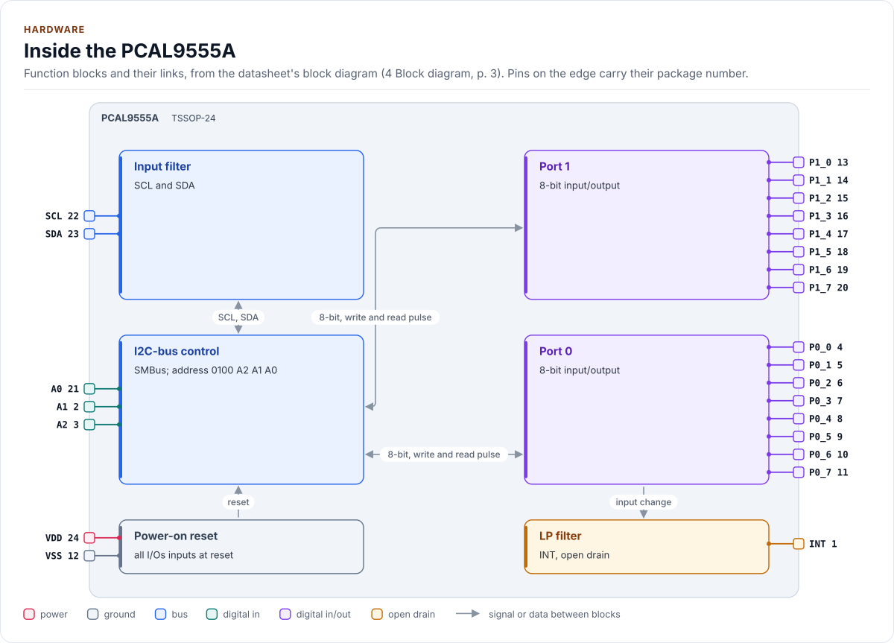
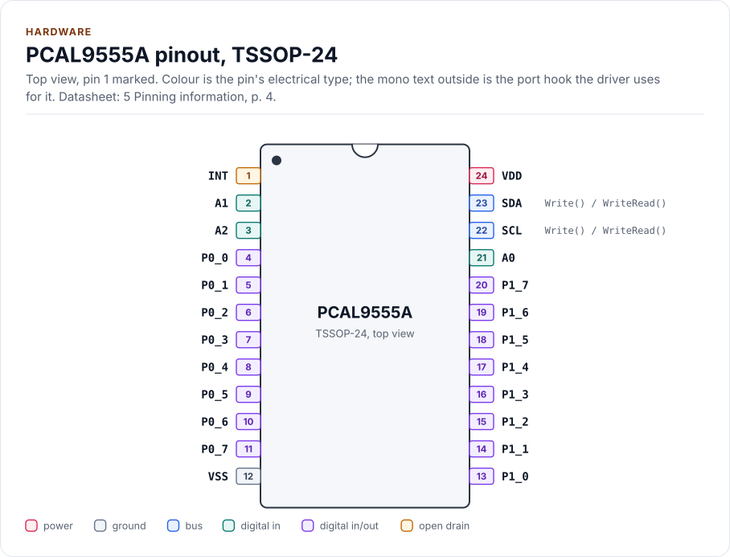
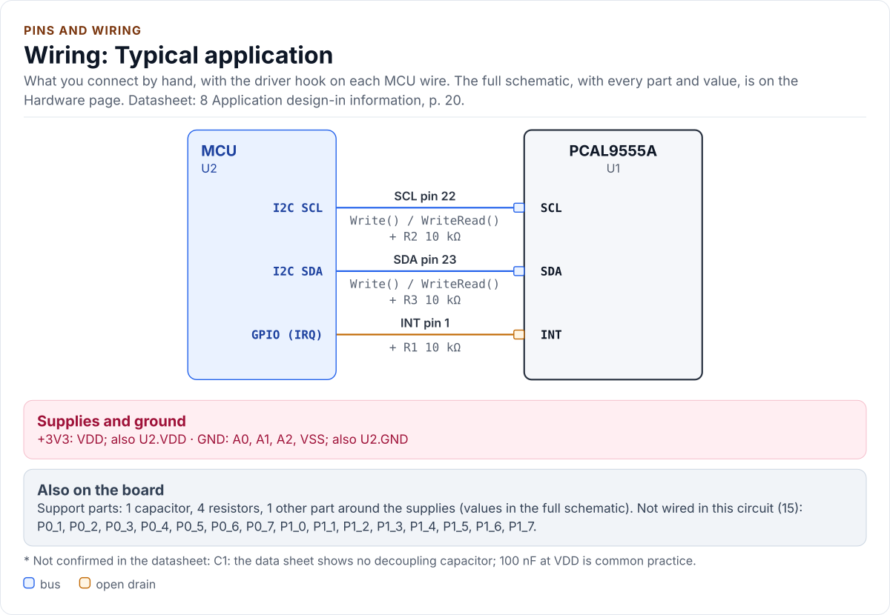

---
hide:
  - navigation
  - toc
---

<div class="kb-hero" markdown>
<span class="kb-kicker">Driver</span>

# PCAL9555 Driver

<p>A C++20 driver for the NXP PCA9555 and PCAL9555A 16-bit I2C GPIO expanders. It drives outputs, reads inputs
and interrupt sources, and on the PCAL9555A sets drive strength, pull resistors, input latches and open-drain
ports, on any MCU.</p>

[Quickstart](quickstart.md){ .md-button .md-button--primary }
[API guide](api-guide.md){ .md-button }
[Source on GitHub](https://github.com/kokeb-labs-drivers/driver-pcal9555){ .md-button }
</div>

<!-- generated: chip-summary -->
The **PCAL9555A** is a 16-bit I/O expander that adds sixteen inputs or outputs on an I2C bus, with an interrupt line for
input changes and, as the Agile I/O of the PCAL9555A, pull resistors, input latches and drive strength per pin (1
General description, [p. 1](https://www.nxp.com/docs/en/data-sheet/PCAL9555A.pdf#page=1)).
<!-- /generated -->

<!-- figure: chip-hero -->
<picture>
  <source media="(prefers-color-scheme: dark)" srcset="diagrams/chip-hero.dark.svg">
  
</picture>
<!-- /figure -->

## What it does

<!-- figure: chip-capabilities -->
<picture>
  <source media="(prefers-color-scheme: dark)" srcset="diagrams/chip-capabilities.dark.svg">
  
</picture>
<!-- /figure -->

## Where it is used

<!-- generated: chip-uses -->
- Power switches
- Sensors
- Push buttons
- LEDs
- Fan control

Uses named by the datasheet (1 General description, [p.
1](https://www.nxp.com/docs/en/data-sheet/PCAL9555A.pdf#page=1)).
<!-- /generated -->

## Inside the chip

<!-- figure: chip-blocks -->
<picture>
  <source media="(prefers-color-scheme: dark)" srcset="diagrams/chip-blocks.dark.svg">
  
</picture>
<!-- /figure -->

## Pins and wiring

<!-- figure: chip-pinout -->
<picture>
  <source media="(prefers-color-scheme: dark)" srcset="diagrams/chip-pinout.dark.svg">
  
</picture>
<!-- /figure -->

<!-- figure: chip-wiring-typical -->
<picture>
  <source media="(prefers-color-scheme: dark)" srcset="diagrams/chip-wiring-typical.dark.svg">
  
</picture>
<!-- /figure -->

<div class="kb-chip" markdown>
<div class="kb-chip__head">
<span class="kb-chip__kicker">16-bit I2C GPIO expander</span>
<span class="kb-chip__name">PCA9555 / PCAL9555A</span>
<span class="kb-chip__vendor">NXP Semiconductors</span>
</div>

Function
:   16 I/O pins in two 8-pin ports; each pin an input or a latched output, with input polarity inversion

Interface
:   I2C up to 400 kHz; 7-bit address `0x20` to `0x27` from the A2, A1 and A0 pins

Interrupt
:   Open-drain INT on any input change, cleared by reading the input port

Agile I/O (PCAL9555A)
:   Four drive strengths per pin, 100 kΩ pull-up or pull-down per pin, input latch, interrupt mask and status,
    push-pull or open-drain per port

Supply
:   PCA9555 2.3 V to 5.5 V; PCAL9555A 1.65 V to 5.5 V
</div>

Every pin, the reference circuits, the bus settings, the timing and the power: [Hardware](hardware.md).

## Quick start

Wire the chip as above, write the port for your MCU ([Porting](porting.md)), then:

<!-- generated: quickstart-code -->
```cpp
#include "pcal9555.hpp"

int blink_and_read(MyPort& port, bool& button_pressed) {
  pcal9555::PCAL9555<MyPort> io(port, 0x20); // A2..A0 low; no I/O yet

  if (auto r = io.EnsureInitialized(); !r) { // 1. bus up, presence, Config{} written, checked
    return static_cast<int>(r.error); //    Bus: nothing at 0x20; DeviceIdMismatch: another part
  }
  const uint16_t led = pcal9555::PinMask(0);   // P0_0 drives an LED to ground
  if (auto r = io.SetOutputs(led, true); !r) { // 2. level first, then direction: no glitch
    return static_cast<int>(r.error);
  }
  if (auto r = io.SetDirection(led, pcal9555::Direction::Output); !r) {
    return static_cast<int>(r.error);
  }

  const auto button = io.ReadPin(8); // 3. P1_0: a button to ground, pulled up externally
  if (!button) {
    return static_cast<int>(button.error);
  }
  button_pressed = !button.value;
  return 0;
}
```
<!-- /generated -->

Step by step, from a bare chip to the first result: [Quickstart](quickstart.md).

## Driver coverage

<!-- generated: chip-coverage -->
| Capability | What the chip does | Driver API | Registers | Status | Datasheet |
| --- | --- | --- | --- | --- | --- |
| [Pin direction](api-guide.md) | Makes each of the 16 pins an input or an output; every pin is an input after power-on | `SetDirection`, `Direction` | `Configuration port 0` (`kConfigPort0`) | Supported | 6.2.5, [p. 8](https://www.nxp.com/docs/en/data-sheet/PCAL9555A.pdf#page=8) |
| [Outputs](api-guide.md) | Sets, writes or toggles latched outputs that sink up to 25 mA, enough to light an LED | `SetOutputs`, `WriteOutputs`, `ToggleOutputs`, `ReadOutputLatch` | `Output port 0` (`kOutputPort0`) | Supported | 6.2.3, [p. 7](https://www.nxp.com/docs/en/data-sheet/PCAL9555A.pdf#page=7) |
| [Inputs and polarity](api-guide.md) | Reads the level of every pin, each one optionally inverted | `ReadInputs`, `ReadPin`, `SetPolarityInversion` | `Input port 0` (`kInputPort0`), `Polarity Inversion port 0` (`kPolarityPort0`) | Supported | 6.2.2, [p. 7](https://www.nxp.com/docs/en/data-sheet/PCAL9555A.pdf#page=7) |
| [Interrupt](api-guide.md) | Pulls the open-drain INT low on an input change; the PCAL9555A adds a mask and the source per pin | `SetInterruptEnabled`, `ReadInterruptStatus`, `GetLatchedInterrupts` | `Input port 0` (`kInputPort0`), `Interrupt mask register 0` (`kInterruptMask0`), `Interrupt status register 0` (`kInterruptStatus0`) | Supported | 6.5, [p. 14](https://www.nxp.com/docs/en/data-sheet/PCAL9555A.pdf#page=14) |
| [Pull-up and pull-down](agile-io.md) | Enables a 100 kΩ pull-up or pull-down per pin, so a button needs no external resistor (PCAL9555A) | `SetPull`, `Pull` | `Pull-up/pull-down enable register 0` (`kPullEnable0`), `Pull-up/pull-down selection register 0` (`kPullSelect0`) | Supported | 6.2.8, [p. 10](https://www.nxp.com/docs/en/data-sheet/PCAL9555A.pdf#page=10) |
| [Input latch](agile-io.md) | Keeps a short input change until the input port is read, so a pulse is not missed (PCAL9555A) | `SetInputLatch` | `Input latch register 0` (`kInputLatch0`) | Supported | 6.2.7, [p. 9](https://www.nxp.com/docs/en/data-sheet/PCAL9555A.pdf#page=9) |
| [Output drive strength](agile-io.md) | Sets one of four output current levels per pin, to tune the edge rate and the switching noise (PCAL9555A) | `SetDriveStrength`, `DriveStrength` | `Output drive strength register 0` (`kDriveStrength0`), `Output drive strength register 1` (`kDriveStrength2`) | Supported | 6.2.6, [p. 9](https://www.nxp.com/docs/en/data-sheet/PCAL9555A.pdf#page=9) |
| [Open-drain outputs](agile-io.md) | Switches each 8-pin port between push-pull and open-drain outputs (PCAL9555A) | `SetOutputMode`, `OutputMode`, `Bank` | `Output port configuration register` (`kOutputPortConfig`) | Supported | 6.2.12, [p. 12](https://www.nxp.com/docs/en/data-sheet/PCAL9555A.pdf#page=12) |
| [Address and reset](contract.md) | Finds the chip at one of eight addresses and notices a power-on reset mid-session | `EnsureInitialized`, `CheckForReset`, `GetAddress` | - | Supported | 6.1, [p. 5](https://www.nxp.com/docs/en/data-sheet/PCAL9555A.pdf#page=5) |

**Supported**: the driver covers it and a host test checks it.

From [`docs/hardware.yml`](hardware.yml); `kokeb-docs hardware --check` confirms that every API name is in
`inc/pcal9555.hpp`, `inc/pcal9555_types.hpp` and every register (the header constant in brackets, where the header
spells it otherwise) in `inc/pcal9555_registers.hpp`.
<!-- /generated -->

The driver has no platform code. You give it a small class that brings the bus up and moves bytes; it does the
rest: the presence and identity checks, the register pairs, the write order that avoids glitches, and a copy of
every register so that a pin change is one transfer, and the check that finds a power-on reset before a stale copy
is written over it.

### What you get

- **One object per chip.** `PCAL9555<YourPort>` takes your port, the address and a `Config`, and does no I/O until
  `EnsureInitialized()`. See [API guide](api-guide.md).
- **Both parts, one API.** `Config::variant` names the part; on a PCA9555 the Agile I/O calls return
  `Unsupported` without touching the bus. See [Agile I/O](agile-io.md).
- **Errors you can act on.** Every call returns `Result<T>` with an `Error` such as `Bus`, `DeviceIdMismatch` or
  `Unsupported`. See [API guide](api-guide.md#handle-errors).
- **Datasheet defaults.** `Config{}` holds the power-up value of every register. See
  [Configuration](configuration.md).
- **A tiny port.** Three bus hooks and an optional log hook, checked by a concept at compile time. The chip needs
  no delays and has no reset pin. See [Porting](porting.md).
- **No heap, no exceptions, no RTTI.** The host tests build with `-fno-exceptions -fno-rtti`. See
  [Contract](contract.md).
- **Tested without hardware.** Host tests run the driver against a protocol model of the chip, with every bus
  transfer failed in turn. See [Testing and CI](testing.md).

## Datasheet

<!-- generated: datasheet-card -->
| Document | Revision | Get it |
| --- | --- | --- |
| Datasheet: PCAL9555A Low-voltage 16-bit I2C-bus GPIO with Agile I/O, interrupt and weak pull-up (NXP PCAL9555A) | Rev. 2, 2014-12-19 | [PDF](https://www.nxp.com/docs/en/data-sheet/PCAL9555A.pdf) · [vendor page](https://www.nxp.com/products/PCAL9555A) |
| Datasheet: PCA9555 16-bit I2C-bus and SMBus I/O port with interrupt (NXP PCA9555) | Rev. 10, 2017-11-08 | [PDF](https://www.nxp.com/docs/en/data-sheet/PCA9555.pdf) · [vendor page](https://www.nxp.com/products/PCA9555) |

Written against these revisions; the SHA-256 of each file is in [`docs/datasheets.yml`](datasheets.yml). Where each part
of the driver is in the datasheet: [Datasheet map](datasheet.md).
<!-- /generated -->

## Where to go next

<div class="grid cards" markdown>

-   :material-rocket-launch-outline: **[Quickstart](quickstart.md)**

    ---

    Wire the chip, write the port, blink an LED and read a button.

-   :material-chip: **[Hardware](hardware.md)**

    ---

    Pins, addresses, bus transactions, interrupt and power.

-   :material-file-document-check-outline: **[Contract](contract.md)**

    ---

    What the driver promises, what it needs, threading and errors.

-   :material-code-braces: **[API guide](api-guide.md)**

    ---

    Start, drive outputs, read inputs, handle interrupts and errors, task by task.

-   :material-tune-variant: **[Agile I/O](agile-io.md)**

    ---

    The PCAL9555A extras: drive strength, pull resistors, latches, interrupt mask.

-   :material-book-open-variant: **[API reference](api-reference.md)**

    ---

    Every class and member, generated from the headers.

</div>
